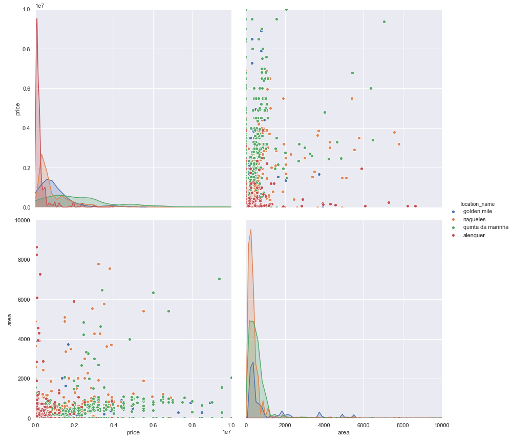
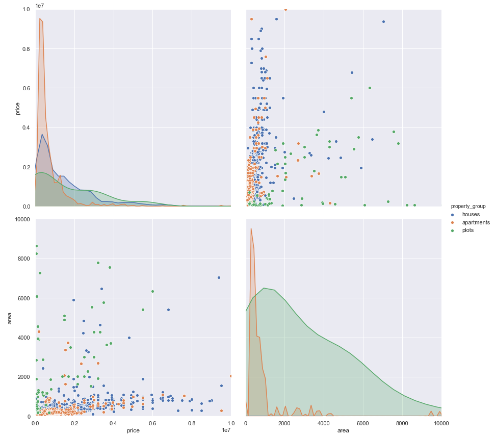
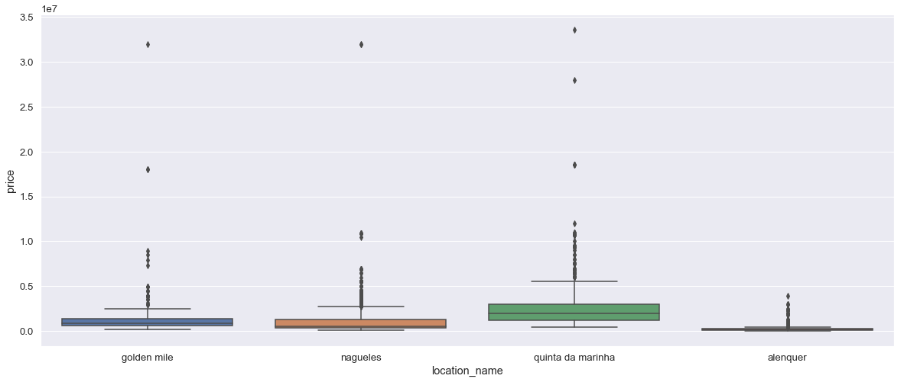
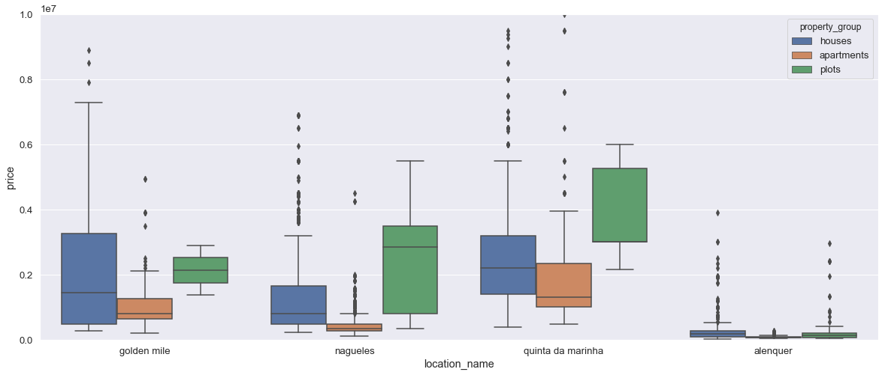
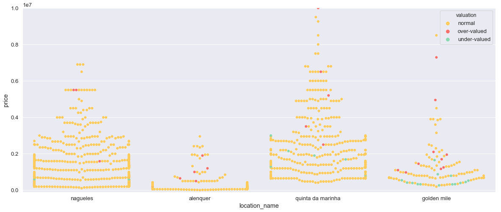
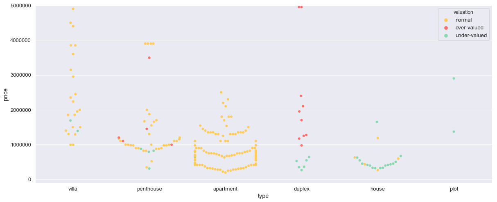

# Data Extraction (CSS + REGEX)

Casafari tracks the entire real estate market by aggregating properties from thousands of different websites. The first step of this process is to collect all the relevant information using web crawlers. This task will give a brief overview of how this extraction is made. 

The task consists of 3 parts, which will evaluate your skills in CSS3 selectors and regular expressions knowledge, which are essential to data extraction processes. We believe that even if you do not have previous knowledge of CSS, HTML and REGEX, you should be able to complete this task in less than a hour. There are many tutorials and informations on how to use CSS3 selectors and regular expressions to extract data. Do not be afraid to google it! This task is also a evaluation of your learning capabilities.

The normal questions already have some examples and can be solved only by filling the CSS3 selectors or the regular expressions in the given space. You can check if you have the correct results by running the pre-made script after it. However, if you feel comfortable, you can use another python package and rewrite the script in a similar way to extract the data.

For the extra challenges, you'll need to construct the scripts from scratch.

__(1)__ For the following task, use the _listing.html_ file, which represents a listings for a property. Open the HTML file on your browser, investigate it with the Inspect tool, view the source code and explore it. 
After that, fill the CSS3 selectors in the following script to extract the following information about this property:

* Number of bathrooms
* Number of bedrooms
* Living Area
* Energy Rating
* Description
* Agent Name
* Extract the location of the property


```python
!pip install lxml
!pip install cssselect
```

    Requirement already satisfied: lxml in c:\users\carlo\miniconda3\lib\site-packages (4.2.5)
    Requirement already satisfied: cssselect in c:\users\carlo\miniconda3\lib\site-packages (1.0.3)
    


```python
# EXAMPLE SELECTOR TO EXTRACT THE PROPERTY TYPE
Selector_Example = "h1.lbl_titulo"
```


```python
# EXAMPLE CODE, RUN TO CHECK THE EXAMPLE SELECTOR 

from lxml import html, etree

with open(r'listing.html', "r") as f:
    page = f.read()
tree = html.fromstring(page)

print('Example -> Property type: {}'.format(tree.cssselect(Selector_Example)[0].text))
```

    Example -> Property type: 3 Bedroom House
    

Now that you understand the example, just fill the CSS selectors here and check it by running the below cells:

*Based on the requests and the source code, I am confident that related selectors should reasonably involve matching mechanisms dealing not just with HTML elements but also with HTML content.<br/>
Based on <https://stackoverflow.com/questions/1520429/is-there-a-css-selector-for-elements-containing-certain-text>, CSS content selectors were deprecated from CSS3. As a replacement, I chose to use XPath Selectors, already provided in the lxml Package.<br/>
The lxml Package supports XPath 1.0: it does not handle regex natively. I reproduced regex functionality in alternative ways.
The result is less readable but does not require importing additional packages.<br/>
E.g. "matches(text(),'[Bb]athrooms')" --> "contains(text(), 'Bathrooms') or contains(text(), 'bathrooms')".<br/>
I implemented selectors by assuming a reasonable degree of robustness as optimality criterion.*


```python
############## Q1 ANSWERS ##################
str_1_4 = "normalize-space(//h2[@class='lbl_descricao_dados']/following-sibling::*/descendant-or-self::*[{}]/following-sibling::*/text())"
cond_1 = "contains(text(), 'Bathrooms') or contains(text(), 'bathrooms')"
Selector_1 = str_1_4.format(cond_1)
cond_2 = "contains(text(), 'Bedrooms') or contains(text(), 'bedrooms')"
Selector_2 = str_1_4.format(cond_2)
cond_3 = "contains(text(), 'Living Area') or contains(text(), 'Living area') or contains(text(), 'living area')"
Selector_3 = "substring-before({}, 'm')".format(str_1_4.format(cond_3))
cond_4 = "contains(text(), 'Energy Rating') or contains(text(), 'Energy rating') or contains(text(), 'energy rating')"
Selector_4 = str_1_4.format(cond_4)
# I assume that the requested "Description" is the one visible in the web page, and not the one included in the metadata.
cond_5 = "@class='lbl_description' and (contains(text(), 'Description') or contains(text(), 'description'))"
Selector_5 = "normalize-space(//h3[{}]/following-sibling::*/text())".format(cond_5)
cond_6 = "@class='lbl_titulo' and (contains(text(), 'Agent') or contains(text(), 'agent'))"
Selector_6 = "substring-after(//*[@class='info1']//*[{}]/text(), 'Agent ')".format(cond_6)
Selector_7 = "normalize-space(//*[@id='Cpl_lbl_morada']/text())"
```

*I used XPath normalize-space(), substring-before() and substring-after() functions. They process the first extracted string only.<br/>
If it is needed to print all extracted strings disable above-mentioned functions and use alternative methods.*


```python
############### RUN TO CHECK YOUR ANSWERS ##################
print('Bathrooms: {}'.format(tree.xpath(Selector_1)))
print('')
print('Bedrooms: {}'.format(tree.xpath(Selector_2)))
print('')
print('Living area: {}'.format(tree.xpath(Selector_3)))    # in square meters
print('')
print('Energy rating: {}'.format(tree.xpath(Selector_4)))
print('')
print('Description: {}'.format(tree.xpath(Selector_5)))
print('')
print('Agent name: {}'.format(tree.xpath(Selector_6)))
print('')
print('Location: {}'.format(tree.xpath(Selector_7)))
print('')
```

    Bathrooms: 1
    
    Bedrooms: 2
    
    Living area: 80 
    
    Energy rating: C
    
    Description: At vero eos et accusamus et iusto odio dignissimos ducimus qui blanditiis praesentium voluptatum deleniti atque corrupti quos dolores et quas molestias excepturi sint occaecati cupiditate non provident, similique sunt in culpa qui officia deserunt mollitia animi, id est laborum et dolorum fugaEt harum quidem rerum facilis est et expedita distinctio.Nam libero tempore, cum soluta nobis est eligendi optio cumque nihil impedit quo minus id quod maxime placeat facere possimus, omnis voluptas assumenda est, omnis dolor repellendus.
    
    Agent name: John Doe
    
    Location: Portugal, Lisboa, Estrela, Lapa
    
    

__Extra Challenge 1__:

Write from scratch a script to extract and print:
* One link that leads to http://mydomain.com/link-to-image
* Extract all the features of the property

*Based on <https://stackoverflow.com/questions/9161769/url-without-httphttps>, I should assume the existence of websites implementing links with Protocol-relative URLs (PRURLs).<br/>
I assume that the given URL is the Canonical URL leading to the specified web page.<br/>
I recommend to include all possible Duplicate URLs in the extraction, given that they are functionally equivalent to the Canonical one.<br/>
By applying a conservative approach, I implemented an extraction robust to PRURLs and Duplicate URLs.<br/>
I used a CSS Selector to extract the first element that is a link leading to the given URL, then I extracted its URL with xpath().*


```python
############### WRITE THE SCRIPT TO SOLVE THE EXTRA CHALLENGE HERE ##################
Selector_8 = "[href*='mydomain.com/link-to-image']"
print('First link containing the string "mydomain.com/link-to-image": {}'.format(tree.cssselect(Selector_8)[0].xpath('@href')[0]))
print('')
Selector_9 = "[id='features']"
print('Extracted property features:')
for w in tree.cssselect(Selector_9):
    print(w.text.strip())
print('')
```

    First link containing the string "mydomain.com/link-to-image": http://mydomain.com/link-to-image
    
    Extracted property features:
    Garden
    Gas Heating
    2 garages
    Large pool
    
    

__(2)__ In the second part you will still have to use the html file. However, this time, you should use regular expressions to extract the following data from the webpage:

* Urls that are links to listings (i.e.: http://mydomain.com/link-to-listing). Do not use the whole url itself in regular expression. It should select only 3 links.
* The agent telephone number
* The property price


```python
# REGEXP EXAMPLE TO EXTRACT THE AGENT EMAIL
Regexp_Example = r"\">(.*?@.*?)<"
```


```python
# RUN TO CHECK THE EXAMPLE RESULTS
import re

with open(r'listing.html', "r", encoding='utf-8') as f:   # set utf-8 encoding to correctly encode EUR symbol
    page = f.read()

print("Email extracted: {}".format(re.findall(Regexp_Example, page)[0]))
```

    Email extracted: casatest@casa.pt
    


```python
# WRITE YOUR REGULAR EXPRESSIONS HERE
Regexp_1 = r"(?:http[s]?://)?(?:www\.)?mydomain.com/link-to-listing(?:\?.*)?"
Regexp_2 = r"[Pp]hone [Nn]umber:\s*([0-9]*?-?[0-9]*?)\s*<"
Regexp_3 = r"[Pp]rice.*?>\s*(.*?)\s*<"
```

*I do not generally recommend using regex for URL matching. The rationale behind my recommendation is well-explained at <https://stackoverflow.com/a/6883228>.<br/>
Nonetheless, I completed the task as requested. I would like to point out that I did not find a regex solution for URLs that is documented as infallible. <br/>
Anyway, this (simple) solution works with the case at hand, as well as with PRURLs and Duplicate URLs involving all possible query strings.*


```python
############### RUN TO CHECK YOUR ANSWERS ##################
print('Links extracted:')
for w in re.findall(Regexp_1, page):
    print(w)
print('')
print("Agent Phone Number: {}".format(re.findall(Regexp_2, page)[0]))
print('')
print("Property price: {}".format(re.findall(Regexp_3, page)[0]))
```

    Links extracted:
    http://mydomain.com/link-to-listing
    http://mydomain.com/link-to-listing
    http://mydomain.com/link-to-listing
    
    Agent Phone Number: 0800-1111
    
    Property price: 1.500.000 €
    

__Extra Challenge 2:__
* Extract latitude and longitude value from html (_those values are in the html code, but are not shown on the page_)


```python
############### WRITE THE SCRIPT TO SOLVE THE EXTRA CHALLENGE HERE ##################
Regexp_4 = "data-coorgps\s*?=\s*?[\"\'](\-?\d+(?:\.\d+)?),\s*?(\-?\d+(?:\.\d+)?)[\"\']"
print("GPS Coordinates: {}".format(tuple(map(float, re.findall(Regexp_4, page)[0]))))
```

    GPS Coordinates: (36.5194999, -4.7743365)
    

__(3)__ For the last task,  use the *sample.json* file. This file contains JSON that has a list of objects inside. Open the file in a code editor, try to identify some pattern on it and check it's structure first. Each object is under unique ID: 


{ 

"SV350": { ... // data, describing the object ... }, 

"fKDFI3": { ... // data, describing the object ... },

...

"38shF": { ... // data, describing the object ... } 

}


Therefore, you need to write one regular expression to extract the following information:
* Every unique ID on this file (for example, the first unique ID should be NC065 and the last should be NN574). 

Hint: The length of your list should be 211

*The most intuitive approach for this task seems to be matching JSON fields which are nested at a specific level.<br/>
Regexs are not recommended for this problem, given that they have no memory. Nonetheless, a regex solution is still possible.<br/>
Objects in this sample have the "Property-No." field, which seems to contain requested ID information.<br/>
Based on the specification, I assume that the outer level contains the true ID a priori.<br/>*

*It is needed to verify whether the "Property-No." field actually contains the true ID.<br/>
Validity proof: get all strings of the type "XXXXX", where X is a capitalized alphanumeric character, then verify that the sorted array of unique values in this list exactly matches the sorted version of the previous extraction.*


```python
import re
import numpy as np
# WRITE YOUR REGULAR EXPRESSION HERE
Regexp_JSON_1 = r'Property-No."\s*,\s*"(.*?)"'
```


```python
with open(r'sample.json', "r") as f:
    json = f.read()

print('----- Expressions extracted -----')
Extraction = re.findall(Regexp_JSON_1, json)
print("First unique id: {}".format(Extraction[0]))
print("Last unique id: {}".format(Extraction[-1]))
print("Length of list of unique ids: {}".format(len(Extraction)))
Regexp_JSON_Valid = r'"([A-Z0-9]{5})"'
Extraction_Val = np.unique(re.findall(Regexp_JSON_Valid, json))
print("Extracted ids are the true ids: {}".format(sorted(Extraction) == sorted(Extraction_Val)))
```

    ----- Expressions extracted -----
    First unique id: NC065
    Last unique id: NN574
    Length of list of unique ids: 211
    Extracted ids are the true ids: True
    

**Extra Challenge 3:**
* Extract all unique IDs that has the expression _"land":"ESP"_ inside (for example, the object SV350 has this expression inside it).

*In addition to the requested extraction I executed a simple extraction yielding the expected result size, which can be used to check for validity.*

*Both extractions have the same size. I double-checked for validity by manually inspecting the correctness of 10 samples.*


```python
############### WRITE THE SCRIPT TO SOLVE THE EXTRA CHALLENGE HERE ##################
Regexp_JSON_2 = '\"([A-Z0-9]{5})\"\s*?:\s*?\{[^\{]*?\"land\"\s*?:\s*?\"ESP\"'
print("Length of list of ids of objects having land=ESP: {}".format(len(re.findall(Regexp_JSON_2, json))))
print("Number of \"ESP\" occurrences in the sample: {}".format(len(re.findall(r'"ESP"', json))))
```

    Length of list of ids of objects having land=ESP: 130
    Number of "ESP" occurrences in the sample: 130
    

# Data Querying (SQL)

You have now collected the data, and cleaned it.  It was published in Casafari database and you have to query the data in order to prepare it for analysis. 

To solve this problem consider the data set provided in _properties.csv_ and _agents.csv_ to test your queries. As before, please fill in your queries in the cells provided (double click the blank cells to fill them in). 

In this task we just want to evaluate your knowledge of SQL syntax, so keep it simple. Do not try to overclean the data in this task. You'll get to do this on the next task with Python.

### Schemas:
- PROPERTIES table: 
  - **id**(PK, INT) - unique identification number of the property ad listing
  - **title**(VARCHAR) - title of the property ad listing
  - **features**(VARCHAR) - field with additional characteristics of the property ad listing
  - **living_area**(FLOAT) - living area of the property in square meters
  - **total_area**(FLOAT)- total area of the property in square meters
   - **plot_area**(FLOAT) - plot area of the property in square meters
  - **price**(FLOAT) - selling price of the property in euros
  - **agent_id**(INT) - selling agent id
  - **createdAt**(DATE) - date in which the property was added to the market
- AGENTS table: 
  - **agent_id**(PK, INT) - selling agent id
  - **company**(VARCHAR) - company for which the agent works

### Details of properties:
- **locations** can be: Alenquer, Quinta da Marinha, Golden Mile, Nagüeles;
- **types** can be: ‘apartment’, ‘penthouse’, ‘duplex’, ‘house’, ‘villa’, ‘country estate’,
‘moradia', ‘quinta', ‘plot’, ‘land’; 
- the property types can be part of the following **property groups**:
  1. group **‘apartments’** includes types ‘apartment’, ‘penthouse’, ‘duplex’;
  2. group **‘‘houses’**‘ includes types ‘house’, ‘villa’, ‘country estate’, ‘moradia', ‘quinta’;
  3. group **‘‘plots’**‘ includes types ’plot’, ‘land’.
- areas:
 - for the group **‘plots’** use **plot_area**;
 - for groups **‘apartments’** and **‘houses’** use the highest value between **total_area** or **living_area**;


### Questions:
- (Q1) Write a query to extract only listings with a property type “quinta” or “house”;
- (Q2) Write a query to extract only listings of properties with a pool;
- (Q3) Write a query calculating the average price per square meter of all apartments in Nagüeles.
- (Q4) Write a query to identify top 3 companies with largest amount of properties
- (Q5) Identify top 3 agents by number of properties within each company


#### HINT:
- Check the csv for these 2 parts. Location names and property type can be found within the title. Be aware of possible traps.


#### Preliminary Data Analysis
By examining the given csv files, I observed that:<br/>
* fields are terminated by a comma;
* entries are terminated by a line feed (\n);
* there are entries characterized by title and features fields enclosed by ";
* there are entries containing line feeds which are not used as line terminators;
    * the first occurrence of this pattern regards the entry with id=132854 and involves the features field;
    * there are entries characterized by a features field in which single features are separated by commas only, line feeds only or both separators at the same time;
    * in some cases line feeds behave as inner separators (e.g. to separate single features from one another).

Relevant additional information (extracted using Excel) and considerations:
* The maximum string length in Properties.title is 132: a VARCHAR column is suitable to this case;
* The maximum string length in Properties.features is 3295: a TEXT column is suitable to this case;
* In Properties area fields the maximum string length is 10 and the maximum #digits after floating point is 2: I chose to represent them as DECIMAL(16,4);
* The maximum string length in Properties.price is 8 and contains only integer values, but I assume its format should encompass cents: I chose to encode price as DECIMAL(16,2);
* The maximum string length in Agents.company is 17: a VARCHAR column is suitable to this case.
* In general, I observed that the property type or other information can be found in the features field as well, so a more conservative approach would be to search for matches also within this field.

#### Environment Setup
Even if I am requested to only write queries, I also included related results by executing my queries from a fully working MySQL platform implemented in this notebook.<br/>
For what concerns character encoding, I applied the utf8mb4 Character Set and the utf8mb4_general_ci Collation, based on the fact that they are options which generally work in most of cases and that provide me with the best results I achieved. All special characters involving Spanish and Portuguese languages (ñ/Ñ included) as well as Swedish and German languages were correctly encoded in the database. Even if some characters are still misencoded (e.g. \x92, \x80, \x9b, \x96, ...), given that for this task I am requested to show my knowledge of SQL syntax I did not address the encoding problem further.<br/>
I would also like to point out that empty fields in the csv are imported as 0 or an empty string.<br/>

Queries were composed by assuming case insensitivity (MySQL default). <br/>


```python
!pip install mysql-connector-python

import os
import pandas as pd
import mysql.connector

def print_query_results(cursor, query, row_limit=64):
    for result in cursor.execute(query, multi=True):
        if result.with_rows:
            ans = result.fetchall()
            print("\nThe query produced {} rows:\n{}".format(result.rowcount, result.column_names))
            print(*ans[:row_limit], sep='\n')
            if len(ans)>row_limit:
                print('[...]')

cnx = mysql.connector.connect(user='zeppelin', password='zeppelin')
cursor = cnx.cursor()
query = """
    SET @@global.local_infile = 1;
# Create Database
    CREATE DATABASE IF NOT EXISTS data;
    USE data;
# Create Properties table
    DROP TABLE IF EXISTS Properties; 
    CREATE TABLE Properties (
        id INT NOT NULL,
        title VARCHAR(256),
        features TEXT,
        living_area DECIMAL(16,4),
        total_area DECIMAL(16,4),
        plot_area DECIMAL(16,4),
        price DECIMAL(16,2),
        agent_id INT,
        created_at DATE,
        PRIMARY KEY (id)
    )
    CHARACTER SET utf8mb4
    COLLATE utf8mb4_general_ci;
# Import Properties data
    LOAD DATA LOCAL INFILE 'properties.csv' INTO TABLE data.Properties
    CHARACTER SET utf8mb4
    FIELDS TERMINATED BY ',' OPTIONALLY ENCLOSED BY '"'
    LINES TERMINATED BY '\\n' STARTING BY ''
    IGNORE 1 ROWS;
# Test Properties for correctness
    SELECT * FROM Properties LIMIT 0, 5;
# Create Agents table
    DROP TABLE IF EXISTS Agents; 
    CREATE TABLE Agents (
        agent_id INT NOT NULL,
        company VARCHAR(64),    # max strlen in sample: 17
        PRIMARY KEY (agent_id)
    )
    CHARACTER SET utf8mb4
    COLLATE utf8mb4_general_ci;
# Import Agents data
    LOAD DATA LOCAL INFILE 'agents.csv' INTO TABLE data.Agents
    CHARACTER SET utf8mb4
    FIELDS TERMINATED BY ',' OPTIONALLY ENCLOSED BY '"'
    LINES TERMINATED BY '\\n' STARTING BY ''
    IGNORE 1 ROWS;
# Test Agents for correctness
    SELECT * FROM Agents LIMIT 0, 5;
# Test join on Agents and Properties
    SELECT Agents.agent_id, Properties.id
    FROM Agents JOIN Properties
    USING(agent_id)
    LIMIT 0, 5;
"""
print_query_results(cursor, query)
```

    Requirement already satisfied: mysql-connector-python in c:\users\carlo\miniconda3\lib\site-packages (8.0.13)
    Requirement already satisfied: protobuf>=3.0.0 in c:\users\carlo\miniconda3\lib\site-packages (from mysql-connector-python) (3.6.1)
    Requirement already satisfied: setuptools in c:\users\carlo\miniconda3\lib\site-packages (from protobuf>=3.0.0->mysql-connector-python) (40.6.3)
    Requirement already satisfied: six>=1.9 in c:\users\carlo\miniconda3\lib\site-packages (from protobuf>=3.0.0->mysql-connector-python) (1.12.0)
    
    The query produced 5 rows:
    ('id', 'title', 'features', 'living_area', 'total_area', 'plot_area', 'price', 'agent_id', 'created_at')
    (44525, 'Stunning 6 bedroom villa in the heart of the Golden Mile, Marbella', '', Decimal('0.0000'), Decimal('918.0000'), Decimal('0.0000'), Decimal('4400000.00'), 184, datetime.date(2018, 3, 9))
    (44859, 'Villa for sale in Rocio de Nagüeles, Marbella Golden Mile', '', Decimal('0.0000'), Decimal('0.0000'), Decimal('0.0000'), Decimal('2400000.00'), 182, datetime.date(2017, 2, 19))
    (45465, 'One level 5 bedroom villa for sale in Nagüeles', '', Decimal('0.0000'), Decimal('393.0000'), Decimal('0.0000'), Decimal('1900000.00'), 154, datetime.date(2017, 4, 17))
    (50685, 'Large estate for sale in Rocio de Nagueles', '', Decimal('0.0000'), Decimal('640.0000'), Decimal('0.0000'), Decimal('4250000.00'), 113, datetime.date(2017, 9, 1))
    (130728, 'Palatial Villa on Marbella\x92s Golden Mile with Panoramic Sea Views', 'Fireplace, Elevator, Terrace, Mountain view, Freight Elevator, Air conditioning, Patio, Guest toilet, Garden, Balcony, Sea/lake view, Built-in kitchen', Decimal('0.0000'), Decimal('4903.0000'), Decimal('11000.0000'), Decimal('32000000.00'), 157, datetime.date(2017, 2, 7))
    
    The query produced 5 rows:
    ('agent_id', 'company')
    (100, 'LuxuryPods')
    (101, 'smartflat.com')
    (102, 'ApartaMinutes')
    (103, 'HouseMouse')
    (104, 'LuxuryPods')
    
    The query produced 5 rows:
    ('agent_id', 'id')
    (184, 44525)
    (182, 44859)
    (154, 45465)
    (113, 50685)
    (157, 130728)
    

###### Query 1: extract only listings with a property type “quinta” or “house”.


```python
query = """
    SET @quinta_filter = "quinta[:space:](do[:space:]ventoso|da[:space:]arrocásia|da[:space:]marinha|do[:space:]bravo|do[:space:]lago)" COLLATE utf8mb4_general_ci;
    SET @house_filter = "(house[:space:]agency|villa[:space:]house|guest[:space:]house|penthouse|country[:space:]house)" COLLATE utf8mb4_general_ci;
    # SELECT Properties.*    # uncomment this line and comment the next line to extract full listings instead of IDs and titles only
    SELECT Properties.id, Properties.title
    FROM Properties INNER JOIN (
        (
            SELECT id
            FROM (
                SELECT id, 
                    REGEXP_REPLACE(title, @quinta_filter, '') AS filtered_title, 
                    REGEXP_REPLACE(features, @quinta_filter, '') AS filtered_features
                FROM Properties
            ) FilteredProperties
            WHERE CONCAT(FilteredProperties.filtered_title, ' ', FilteredProperties.filtered_features)
                REGEXP '(^|[^[:alpha:]])quinta($|[^[:alpha:]])'
        ) UNION (
            SELECT id
            FROM (
                SELECT id,
                    REGEXP_REPLACE(title, @house_filter, '') AS filtered_title, 
                    REGEXP_REPLACE(features, @house_filter, '') AS filtered_features
                FROM Properties
            ) FilteredProperties
            WHERE CONCAT(FilteredProperties.filtered_title, ' ', FilteredProperties.filtered_features)
                REGEXP '(^|[^[:alpha:]])(townhouse|house)($|[^[:alpha:]])'
        )
    ) QuintasAndHouses USING(id)
"""
print_query_results(cursor, query)
```

    
    The query produced 855 rows:
    ('id', 'title')
    (1477164, 'Apartamento T2 - Remodelado - Quinta da Arrocásia, Alenquer')
    (1540267, 'ALQ001 - Quinta em Alenquer')
    (1542674, 'Fantástica Quinta em Alenquer inserida num lote de terreno com7 hectares e um anexo pré fabricado Alenquer \x9b Vila Verde dos Fran')
    (1563978, 'Quinta - T10 - Venda - Abrigada e Cabanas de Torres, Alenquer')
    (1563979, 'Quinta - Venda - Abrigada e Cabanas de Torres, Alenquer')
    (1563980, 'Quinta - Venda - Abrigada e Cabanas de Torres, Alenquer')
    (1563982, 'Quinta - T11 - Venda - Alenquer (Santo Estêvão e Triana), Alenquer')
    (1563983, 'Quinta - T10 - Venda - Aldeia Galega da Merceana e Aldeia Gavinha, Alenquer')
    (1563984, 'Quinta - T9 - Venda - Aldeia Galega da Merceana e Aldeia Gavinha, Alenquer')
    (1563985, 'Quinta - Venda - Abrigada e Cabanas de Torres, Alenquer')
    (1563986, 'Quinta - T4 - Venda - Alenquer (Santo Estêvão e Triana), Alenquer')
    (1586264, 'Quinta do Ventoso - Quinta por recuperar com potencial para projecto de hotelaria ou casa familiar a 30 km de Lisboa Alenquer \x9b ')
    (1885156, 'O LUXO na Quinta da Marinha - Cascais (Moradia T3)')
    (1944869, 'Moradia Isolada Venda em Alenquer (Santo Estêvão e Triana),Alenquer')
    (2546652, 'Quinta - Venda - Alenquer (Santo Estêvão e Triana), Alenquer')
    (2546655, 'Quinta - Venda - Alenquer (Santo Estêvão e Triana), Alenquer')
    (2774935, 'Quinta em Alenquer')
    (2882084, 'Moradia T3 - Condomínio Quinta do Sol -  Albarróis -  Alenquer')
    (2963234, 'Moradia Isolada Venda em Alenquer (Santo Estêvão e Triana),Alenquer')
    (3006343, 'Moradia T4 (Lisboa / Alenquer)')
    (3031210, 'Moradia Isolada Venda em Alenquer (Santo Estêvão e Triana),Alenquer')
    (3168060, 'Quinta - T9 - Venda - Aldeia Galega da Merceana e Aldeia Gavinha, Alenquer')
    (3219453, 'Quinta V5 | Alenquer')
    (3222358, 'Moradia T3 - Condomínio Quinta do Sol -  Albarróis -  Alenquer')
    (3231525, 'Quinta - T4 - Venda - Alenquer (Santo Estêvão e Triana), Alenquer')
    (3396129, '100% Financiado Quinta T7 Alenquer')
    (3399168, '100% Financiado Quinta T7 Alenquer')
    (3425543, 'Quinta  Alenquer \x9b Abrigada e Cabanas de Torres')
    (3425783, 'Quinta  Alenquer \x9b Alenquer (Santo Estêvão e Triana)')
    (3447346, 'Quinta na zona de Alenquer')
    (3447638, 'Quinta na zona de Alenquer')
    (131589, 'Beautifully Presented Corner Townhouse in el Tomillar de Nagüeles')
    (131650, 'Great opportunity new townhouse in a top area of Nagüeles')
    (131765, 'Townhouse at the best price in Nagüeles')
    (131820, 'Charming Townhouse in Nagüeles')
    (134273, '4 bedroom townhouse for sale, Solana de Nagueles, Marbella Milla de Oro, Malaga Costa del Sol, Andalucia')
    (134363, '3 bedroom townhouse for sale, Rocio de Nagueles, Marbella Milla de Oro, Malaga Costa del Sol, Andalucia')
    (134574, '3 bedroom townhouse for sale, Nagueles, Marbella Golden Mile, Malaga Costa del Sol')
    (134581, '3 bedroom townhouse for sale, Nagueles, Marbella Ciudad y Milla de Oro, Malaga Costa del Sol, Andalucia')
    (137573, '3 bedroom townhouse for sale in prime location, Nagueles, Marbella Golden Mile')
    (138247, 'Lovely House in Cortijo de Nagüeles')
    (138452, 'Semi Detached House for sale in Nagüeles, Marbella Golden Mile. Charming Townhouse in Corona de Nagueles on Marbella Golden Mile')
    (138460, 'Townhouse in La Corona de Nagüeles')
    (138518, 'Town House for sale in Corona de Nagüeles, Marbella Golden Mile. Andalusian Inscripted Townhouse')
    (138523, 'Nagüeles, Mountainside Townhouse')
    (138534, 'Rocio de Nagüeles, House in Rocio de Nagüeles')
    (139742, 'Nagüeles, Townhouse in an exclusive gated community on the Golden Mile')
    (140062, 'Nagüeles, Corner Townhouse near Marbella')
    (141963, 'Townhouse in Top Residential Area of Nagüeles')
    (146049, 'Town House for Sale in Montepiedra,  Marbella Golden Mile')
    (146648, 'Semi Detached House for Rent in El Oasis Club,  Marbella Golden Mile')
    (149229, 'Property Details\nTownhouse in Oasis de Nagueles - NAGUELES')
    (149263, 'Property Details\n3 bedroom Townhouse in Nagüeles - NAGUELES')
    (149281, 'Property Details\nTownhouse for Sale in Pueblo Bermejo - NAGUELES')
    (149285, 'Property Details\nHouse for Sale in Montepiedra Urbanisation - NAGUELES')
    (153280, 'Townhouse for Sale in Nagüeles')
    (153719, 'Townhouse for Sale in Nagüeles')
    (153976, 'Townhouse for Sale in Nagüeles')
    (155289, 'Townhouse for Sale in Nagüeles')
    (155678, 'Townhouse for Sale in Nagüeles')
    (156323, 'Townhouse for Sale in Nagüeles')
    (156440, 'Townhouse for Sale in Nagüeles')
    (157038, 'Townhouse for Sale in Nagüeles')
    (157367, 'Townhouse for Sale in Nagüeles')
    [...]
    

##### Trap
The property type can be found within title and features fields, but they also includes information unrelated to the property type which matches with the strings of the requested types (e.g. "quinta da marinha").<br/>
* There are many locations which include the word "Quinta", and I observed the presence of many misspelled location names (as expected). I manually included just a few of them in the filter, but this task requires more time and automation in order to accomplish it properly.<br/>
* In general, it is recommended not to rely on case to discriminate on word meaning; I also observed the presence of wrong case usage in this dataset (e.g. quinta da marinha).<br/>

##### Trap
"House" is a word that should be reasonably found as translated in other languages: I need more field expertise and information to identify proper translations of this term for matching.<br/>
* I assume that "quinta", on the other hand, is a term that should not be reasonably translated in other languages.
* I assume that a "townhouse"/"town house" belongs to the "house" property type.
* Based on the entries having titles "Elegant villa with guest house in [...]" and "Villa house in [...]", I assume that a "guest house" or a "villa house" do not belong to the "house" property type. The same applies to "country house" instances, which clearly refer to "country estate".
* The string "house agency" clearly refers to an agency: a match on this string does not entail a "house" association.

##### Solution
My initial intent was to implement a regex able to match titles and features with the desired property type strings but also to exclude false positives (i.e. unrelated matches, e.g. titles containing "penthouse" or "Quinta da Marinha" should not be matched); unfortunately MySQL does not support regex with negative lookaheads: I had to find another way. My final solution involves the union of two queries characterized by the IDs of those listings which properly match respectively quintas and houses. The "proper match" is implemented with two nested table functions: the inner one removes from fields all substrings enclosing unwanted events (e.g. "penthouse"), then the outer one matches the output directly with the desired property type strings (e.g. "house").<br/>

##### Query 2: extract only listings of properties with a pool.


```python
query = """
    SET @filter = "pool[:space:]view|vista[:space:](a[:space:]la[:space:])?piscina|blick[:space:]auf[:space:]den[:space:]pool" COLLATE utf8mb4_general_ci;
    # SELECT Properties.*    # uncomment this line and comment the next line to extract full listings instead of IDs and titles only
    SELECT Properties.id, Properties.title
    FROM Properties INNER JOIN (
        SELECT id, filtered_title
        FROM (
            SELECT id, REGEXP_REPLACE(title, @filter, '') AS filtered_title,
                REGEXP_REPLACE(features, @filter, '') AS filtered_features
            FROM Properties
        ) FilteredProperties
        WHERE CONCAT(FilteredProperties.filtered_title, ' ', FilteredProperties.filtered_features) 
            REGEXP '(^|[^[:alpha:]])(pool|piscina|schwimmbecken|piscine|gemensam[[:space:]]+fond)($|[^[:alpha:]])'
    ) Pools USING(id);
"""
print_query_results(cursor, query)
```

    
    The query produced 1979 rows:
    ('id', 'title')
    (130857, 'Modern Design Penthouse on second line beach Golden Mile')
    (130897, 'Spacious Beachside Villa Casablanca Marbella Golden Mile')
    (130917, 'Modern Designer Villa with Stunning Views Golden Mile')
    (130978, 'Beautiful Villa at the top of Nagüeles with panoramic views')
    (131037, 'Luxurious Villa in Private Gated Community Marbella Golden Mile')
    (131058, 'Villa in Luxurious Gated Community Marbella Golden Mile')
    (131259, 'Beachfront Penthouse Sea Views Las Cañas Marbella Golden Mile')
    (131274, 'Duplex penthouse in Nagüeles with panoramic views')
    (131297, 'Opportunity to Buy Beachfront Villa under \x801 Million on the Golden Mile')
    (131403, "Beautiful Penthouse in the heart of the Marbella's Golden Mile at a good price")
    (131512, 'Beautiful Villa for sale in Nagüeles Marbella')
    (131589, 'Beautifully Presented Corner Townhouse in el Tomillar de Nagüeles')
    (131650, 'Great opportunity new townhouse in a top area of Nagüeles')
    (131694, 'Exceptional beachfront apartment opportunity in Port Oasis Golden Mile')
    (131703, 'Beautiful corner Apartment with private entrance in Nagüeles')
    (131765, 'Townhouse at the best price in Nagüeles')
    (131820, 'Charming Townhouse in Nagüeles')
    (131878, 'Bright apartment with private garden in Nagüeles')
    (131958, 'Modern villa frontline beach - Golden Mile')
    (131977, 'Magnificent Villa - Golden Mile')
    (132013, 'Charming Villa in Nagüeles')
    (132037, 'Small beachside villa in Oasis Club on the Golden Mile')
    (132041, 'Amazing beachside villa on the Golden Mile')
    (132049, 'Villa close to beach on the Golden Mile - Prices for long term or short term on request')
    (132055, 'Exclusive Beachfront Villa Marbella Golden Mile')
    (132854, 'Large estate for sale in Rocio de Nagueles')
    (133646, '13 bedroom villa for sale, Nagueles, Marbella, Malaga Costa del Sol, Marbella Golden Mile')
    (133676, '8 bedroom villa for sale, Nagueles, Marbella, Malaga Costa del Sol, Marbella Golden Mile')
    (133733, '5 bedroom villa for sale, Nagueles, Marbella, Malaga Costa del Sol, Marbella Golden Mile')
    (133780, '5 bedroom villa for sale, Nagueles, Marbella Golden Mile, Malaga Costa del Sol')
    (133794, '5 bedroom villa for sale, Nagueles, Marbella, Malaga Costa del Sol, Marbella Golden Mile')
    (133831, '3 bedroom apartment for sale, El Oasis Club, Marbella Golden Mile, Malaga Costa del Sol')
    (133908, '5 bedroom villa for sale, Nagueles, Marbella Golden Mile, Malaga Costa del Sol')
    (133938, '5 bedroom villa for sale, Nagueles, Marbella Golden Mile, Malaga Costa del Sol')
    (133960, '10 bedroom villa for sale, Nagueles, Marbella, Malaga Costa del Sol, Marbella Golden Mile')
    (133961, '2 bedroom apartment for sale, Marina Mariola, Golden Mile, Malaga Costa del Sol, Andalucia')
    (134014, '2 bedroom apartment for sale, Alhambra del Mar, Marbella Golden Mile, Malaga Costa del Sol')
    (134023, '4 bedroom villa for sale, Cortijo Nagueles, Marbella Golden Mile, Malaga Costa del Sol')
    (134051, '3 bedroom penthouse for sale, Alhambra del Mar, Marbella Golden Mile, Malaga Costa del Sol')
    (134086, '2 bedroom penthouse for sale, Mansion Club, Marbella, Malaga Costa del Sol, Marbella Golden Mile')
    (134101, '4 bedroom villa for sale, Nagueles, Marbella Milla de Oro, Malaga Costa del Sol, Andalucia')
    (134124, '2 bedroom apartment for sale, Mansion Club, Marbella Golden Mile, Malaga Costa del Sol')
    (134252, '3 bedroom villa for sale, Nagueles, Marbella Milla De Oro, Malaga Costa del Sol, Andalucia')
    (134273, '4 bedroom townhouse for sale, Solana de Nagueles, Marbella Milla de Oro, Malaga Costa del Sol, Andalucia')
    (134363, '3 bedroom townhouse for sale, Rocio de Nagueles, Marbella Milla de Oro, Malaga Costa del Sol, Andalucia')
    (134574, '3 bedroom townhouse for sale, Nagueles, Marbella Golden Mile, Malaga Costa del Sol')
    (134581, '3 bedroom townhouse for sale, Nagueles, Marbella Ciudad y Milla de Oro, Malaga Costa del Sol, Andalucia')
    (138449, 'Rocio de Nagüeles, Modern villa in the heart of the Golden Mile with sea views')
    (138638, 'Rocio de Nagüeles, Lovely Villa In the Golden Mile')
    (138655, 'Nagüeles, Splendid duplex penthouse with sea views')
    (138682, 'Ground Floor Apartment for sale in Mansion Club, Marbella Golden Mile. Ground floor in Mansion Club')
    (138731, 'Ground Floor Apartment for sale in Mansion Club, Marbella Golden Mile. Magnificient apartment in Mansion Club, Marbella Golden M')
    (138771, 'Apartment for sale in Mansion Club, Marbella Golden Mile. Nice apartment in Mansion Club, Marbella Golden Mile')
    (138830, 'Apartment for sale in Mansion Club, Marbella Golden Mile. Completely new apartment in Mansion Club')
    (138885, 'Apartment for sale in Mansion Club, Marbella Golden Mile. Apartment in Mansion Club')
    (138998, 'Penthouse for sale in Mansion Club, Marbella Golden Mile. Penthouse in Mansion Club, Marbella Golden Mile')
    (139021, 'Beach Side Golden Mile, Duplex Penthouse in Alhambra del Mar')
    (139050, 'Rocio de Nagüeles, Villa in Rocio de Nagueles')
    (139068, 'Beach Side Golden Mile, Villa in Prestigious Gated Urbanization')
    (139438, 'Los Pinos de Nagüeles, Garden Apartment on the Golden Mile')
    (139660, 'Villa for sale in Rocio de Nagüeles, Marbella Golden Mile. Elegant villa for sale in Rocio de Nagüeles, Marbella Golden Mile')
    (139769, 'Beach Side Golden Mile, Imposing Frontline Beach Villa')
    (139789, 'Villa for sale in Nagüeles, Marbella Golden Mile. Palatial villa in the heart of Nagüeles')
    (139937, 'Villa for sale in Nagüeles, Marbella Golden Mile. A dreamed moder villa in Nagueles')
    [...]
    

The "pool" feature appears in both title and features fields.<br/>

##### Trap
"Pool" can be reasonably found as translated in other languages: occurrences of "piscina" and "piscine" were found.<br/>

##### Trap
"Pool view" does not necessarily mean that the property is provided with a pool.<br/>
* I can choose whether to exclude from the query entries having the "pool view" feature or to disable their match through this exact feature only (analogously to Query 1). I chose the latter option because I believe it is more conservative: listings having both "pool" and "pool view" features would be included only with the chosen option.<br/>
* In addition, there are feature fields containing features of the type "Views Mountain, Garden, Pool": their match should be excluded. A reasonable approach to tackle this problem is to deal with each single feature and identify the "view" string in it.
    * One simple regex solution would be the following: if both "pool" and "view" occurrences are identified within the same feature field then pool matching is negative, whereas if just "pool" is identified then pool matching is positive; feature field boundaries can be auspicably given by line feeds, as it has been observed in some records.
    * Simple solutions to this subproblem are based on strong assumptions or thorough manual-engineering: I do not have enough time available to deal with this task at this time.<br/>
* I assume that properties with communal pools are part of the requested target.<br/>

##### Solution
Two nested table functions allow to retrieve listings characterized by a proper match. In particular, the inner table function preprocesses the listings so as to prevent false positives (i.e. unrelated matches, e.g. "pool view"), then the outer one matches the output directly with the desired feature.<br/>

##### Query 3: write a query calculating the average price per square meter of all apartments in Nagüeles.


```python
query = """
    SET @filter = "(guest|separate)[:space:]apartment" COLLATE utf8mb4_general_ci;
    SELECT AVG(price_per_m2_in_nagueles) AS avg_price_per_m2_in_nagueles
    FROM (
        SELECT price/GREATEST(total_area, living_area) AS price_per_m2_in_nagueles
        FROM (
            SELECT DISTINCT id
            FROM (
                SELECT id
                FROM (
                    SELECT id, 
                        REGEXP_REPLACE(title, @filter, '') AS filtered_title, 
                        REGEXP_REPLACE(features, @filter, '') AS filtered_features
                    FROM Properties
                ) FilteredProperties
                WHERE CONCAT(FilteredProperties.filtered_title, ' ', FilteredProperties.filtered_features)
                    REGEXP '(^|[^[:alpha:]])(apartment|apartamento)($|[^[:alpha:]])'
            ) Apartments INNER JOIN (
                SELECT id
                FROM Properties
                WHERE CONCAT(Properties.title, ' ', Properties.features) REGEXP
                    '(^|[^[:alpha:]])nag[üu]eles($|[^[:alpha:]])'
            ) InNagueles USING(id)
        ) ApartmentsInNagueles INNER JOIN Properties USING(id)
    ) PricesPerM2InNagueles
"""
print_query_results(cursor, query)
```

    
    The query produced 1 rows:
    ('avg_price_per_m2_in_nagueles',)
    (Decimal('2980.1001652888'),)
    

All locations can be found in titles and features.<br/>
"Apartment" can be found in titles and features.<br/>

##### Trap
There are villas and townhouses having "guest apartment" or "separate apartment" as a feature.
* Related match occurrences can be excluded as in previous queries.<br/>

##### Trap
"Apartment" can be reasonably found as translated in other languages.<br/>
* A solution analogous to that for Query 2 can be easily implemented but I do not have enough time to acquire sufficient field expertise to be able to discriminate over property types in all their translations. I included just "apartamento".

##### Trap
Both total_area and living_area can be 0: the consequent division by 0 in price/MAX(total_area, living_area) results in a None value.
* Fortunately, AVG() calculates the average over all known values only (which I assume is the expected behavior).

##### Trap
In general, string instances containing special characters are likely to be misspelled in a non-negligible way. In this case study, given data contains many "Nagüeles" instances spelled as "Nagueles".

##### Trap
Nagüeles (or any general location) may have alternative names: it would be a good idea to take them into account.

##### Query 4: Identify top 3 companies with largest amount of properties.


```python
query = """    
    SELECT Agents.company, COUNT(Properties.id) AS amount
    FROM Agents LEFT JOIN Properties USING(agent_id)
    GROUP BY Agents.company
    ORDER BY amount DESC
    LIMIT 0, 3
"""
print_query_results(cursor, query)
```

    
    The query produced 3 rows:
    ('company', 'amount')
    ('Ramax', 1151)
    ('LuxuryPods', 978)
    ('smartflat.com', 824)
    

Given that Agents.agent_id contains all integers in the range [100,200), Properties.agent_id does not contain missing values or values not described in Agents.agent_id: referential integrity holds in the resulting database.<br/>
Using an outer join in place of an inner join allows to possibly retrieve records characterized by count=0 (e.g. companies with 0 properties).

##### Query 5: Identify top 3 agents by number of properties within each company.


```python
query = """
    SELECT company, 
        SUBSTRING_INDEX(GROUP_CONCAT(agent_id ORDER BY agent_cnt DESC SEPARATOR ', '), ',', 3) top_agent_ids
    FROM (
        SELECT agent_id, MAX(company) AS company, COUNT(id) AS agent_cnt
        FROM Agents LEFT JOIN Properties USING(agent_id)
        GROUP BY agent_id
    ) AgentCounts
    GROUP BY company
    ORDER BY company ASC
"""
print_query_results(cursor, query)
```

    
    The query produced 6 rows:
    ('company', 'top_agent_ids')
    ('ApartaMinutes', '120, 141, 177')
    ('HouseMouse', '176, 172, 121')
    ('LuxuryPods', '196, 100, 140')
    ('Ramax', '127, 194, 109')
    ('ShoeboxApartments', '154, 162, 118')
    ('smartflat.com', '110, 150, 156')
    

**Extra challenge 4:**
- (Q6) Write a query to identify companies with most expensive properties for each month in 2017
- (Q7) Write a query to get first and last property posted by each company

##### Query 6: identify companies with most expensive properties for each month in 2017.


```python
query = """
    SELECT month, 
        GROUP_CONCAT(company ORDER BY month ASC SEPARATOR ', ') AS most_expensive_companies,
        price AS max_price
    FROM Agents RIGHT JOIN(
        SELECT agent_id, month, price
        FROM Properties INNER JOIN (
            SELECT MAX(price) AS max_price, MONTH(created_at) AS month, YEAR(created_at) as year
            FROM Properties
            WHERE YEAR(created_at) = 2017
            AND MONTH(created_at) > 0    # exclude entries with missing month
            GROUP BY MONTH(created_at)
            ORDER BY MONTH(created_at)
        ) MaxPrices
        ON YEAR(created_at) = year
        AND MONTH(created_at) = month
        AND price = max_price
    ) MaxPriceAgentIds USING(agent_id)
    GROUP BY month
    ORDER BY month
"""
print_query_results(cursor, query)
```

    
    The query produced 12 rows:
    ('month', 'most_expensive_companies', 'max_price')
    (1, 'Ramax', Decimal('18500000.00'))
    (2, 'Ramax', Decimal('32000000.00'))
    (3, 'ApartaMinutes, LuxuryPods', Decimal('18000000.00'))
    (4, 'Ramax, ShoeboxApartments', Decimal('8500000.00'))
    (5, 'smartflat.com', Decimal('18500000.00'))
    (6, 'ShoeboxApartments', Decimal('18500000.00'))
    (7, 'LuxuryPods', Decimal('32000000.00'))
    (8, 'Ramax', Decimal('18500000.00'))
    (9, 'Ramax', Decimal('10750000.00'))
    (10, 'LuxuryPods', Decimal('11736300.00'))
    (11, 'smartflat.com', Decimal('9500000.00'))
    (12, 'ApartaMinutes, smartflat.com, Ramax', Decimal('10900000.00'))
    

I assume that I am requested to take into account just the properties characterized by the maximum price for each month; more complex alternatives would be given by considering the properties characterized by the top n highest prices per month, or the properties characterized by the prices falling in the last percentile.<br/>

##### Trap
Multiple listings may have the same price and multiple companies may substantially share the same listing: the request can be accomplished first by retrieving the price of the most expensive property for each month, then by retrieving companies with properties characterized by that price for each month.

##### Query 7: get first and last property posted by each company.


```python
query = """
    SELECT company, MIN(created_at) AS min_date, MAX(created_at) AS max_date, 
        GROUP_CONCAT(extreme_property_ids ORDER BY created_at ASC SEPARATOR ' | ') AS extreme_property_ids
    FROM (
        SELECT company, created_at, GROUP_CONCAT(id ORDER BY id ASC SEPARATOR ', ') AS extreme_property_ids
        FROM (
            SELECT company, MIN(created_at) AS min_date, MAX(created_at) AS max_date
            FROM Agents LEFT JOIN Properties USING(agent_id)
            GROUP BY company
        ) ExtremeDates LEFT JOIN (
            SELECT id, created_at, company
            FROM Properties LEFT JOIN Agents USING(agent_id)
        ) AgentsAndProperties USING(company)
        WHERE (created_at = min_date OR created_at = max_date)
        GROUP BY company, created_at
    ) ExtremeProperties
    GROUP BY company
"""
print_query_results(cursor, query)
```

    
    The query produced 6 rows:
    ('company', 'min_date', 'max_date', 'extreme_property_ids')
    ('ApartaMinutes', datetime.date(2017, 1, 1), datetime.date(2018, 7, 31), '1884828, 2905657, 2910432 | 1240451, 1667471')
    ('HouseMouse', datetime.date(2017, 1, 1), datetime.date(2018, 7, 31), '3075481 | 3360813')
    ('LuxuryPods', datetime.date(2017, 1, 1), datetime.date(2018, 7, 31), '1563980, 1641927, 2546019, 2786817 | 1011110')
    ('Ramax', datetime.date(2017, 1, 1), datetime.date(2018, 7, 31), '2774331 | 262734')
    ('ShoeboxApartments', datetime.date(2017, 1, 2), datetime.date(2018, 7, 29), '494883 | 1240871')
    ('smartflat.com', datetime.date(2017, 1, 1), datetime.date(2018, 7, 31), '1509380, 2644857 | 157929, 1383507, 1656865')
    

I assume that I am requested to take into account the properties characterized by the first and last dates for each company.<br/>

##### Trap
Multiple listings may be characterized by the same date: the request can be accomplished first by retrieving the first and last dates for each company, then by retrieving all listings created at those dates for each company.


```python
cnx.close()    # close the connection to the database
```

# Data Analysis (Python)


You obtained all the data that you need and you now need to run an analysis on the following problem. For this part, feel free to use as many cells as you need below this point. Please use properties.csv as your data source. 


## Problem 
A private investor is planning an investment in one of the four locations. In order to decide where to invest he needs to know the price impact of such features as ‘pool’, ‘sea view’ and ‘garage’ on properties in each location.
He also asks for the mean price of the properties in each type group (‘apartments’, ‘houses’, ‘plots’) and wants to know about properties in the market that are undervalued and overvalued. In order to accomplish the problem that was described we want you to cover the following steps:

#### Part 1: Data Cleaning
As you have seen previously, a lot of information is present in the title/features fields. From there, we want to extract the relevant information for further analysis, such as:
 - 1A: Property  **type** (as presented in **Details** above, described in the SQL section) of each property from **title** field
 - 1B: Property **location** (as presented in **Details** above, described in the SQL section) of each property from **title** field
 - 1C: From **features** field, if a property has:
  - a pool
  - a garage
  - sea view

#### Expected Outcome for Part 1:
- Create a property dataset with the following schema and save it in a csv file:
  - id; 
  - location name
  - type
  - title
  - features
  - pool (0/1)
  - sea view (0/1)
  - garage (0/1)
- Pool, sea view and garage should be binary:1 if the property has the feature and 0 if not
- For each of the 3 tasks (1A, 1B, 1C), describe in detail the what you did. What are the advantages and disadvantages of your approach?
-  Please provide your code in the cells below, in a reproducible and understandable way;

### Frame the problem
The general target of this problem basically consists in Casafari's mission, which is to provide real estate professionals with hyperlocal and relevant data in order to help them stay competitive and successful. In particular, the focus here is on 4 specific Iberian locations, which means that all insights should possibly be location-aware.

Objectives:
* Price impact of property features (starting from pool, sea view and garage);
* Mean price of properties in each type group;
* Insights on undervalued/overvalued properties.<br/>

I am requested to use the Properties data.

#### Initialization
I used Conda 4.5.11 with Python 3.6.6 (latest versions at date) on a Windows 10 64-bit OS to set up my PyData stack.

Let us first import properties data into a DataFrame; the standard `utf8` encoding suits our case. Resulting data contains character sequences represented as `"\xXX"` where X is an hex value, as we can notice in the two exemplar lines I retrieved below.

I also set a predefined random seed so as to ensure experiment repeatability for any action involving random components.


```python
import sys
import pandas as pd
print('Python version: {}\nPandas version: {}'.format(sys.version, pd.__version__))

seed = 0    # parameterized random_state value for experiment repeatability
sample_sz = 16
# seed = 0 and sample_sz=16 to comply with my observations in related results

df = pd.read_csv('properties.csv', encoding='utf8')
display(df.head())
print('4th entry: {}\n15th entry:{}\n'.format([*df.iloc[4]], [*df.iloc[15]]))
```

    Python version: 3.6.6 | packaged by conda-forge | (default, Jul 26 2018, 11:48:23) [MSC v.1900 64 bit (AMD64)]
    Pandas version: 0.23.4
    


<div>
<style scoped>
    .dataframe tbody tr th:only-of-type {
        vertical-align: middle;
    }

    .dataframe tbody tr th {
        vertical-align: top;
    }

    .dataframe thead th {
        text-align: right;
    }
</style>
<table border="1" class="dataframe">
  <thead>
    <tr style="text-align: right;">
      <th></th>
      <th>id</th>
      <th>title</th>
      <th>features</th>
      <th>living_area</th>
      <th>total_area</th>
      <th>plot_area</th>
      <th>price</th>
      <th>agent_id</th>
      <th>created_at</th>
    </tr>
  </thead>
  <tbody>
    <tr>
      <th>0</th>
      <td>44525</td>
      <td>Stunning 6 bedroom villa in the heart of the G...</td>
      <td>NaN</td>
      <td>NaN</td>
      <td>918.0</td>
      <td>NaN</td>
      <td>4400000</td>
      <td>184</td>
      <td>2018-03-09</td>
    </tr>
    <tr>
      <th>1</th>
      <td>44859</td>
      <td>Villa for sale in Rocio de Nagüeles, Marbella ...</td>
      <td>NaN</td>
      <td>NaN</td>
      <td>NaN</td>
      <td>NaN</td>
      <td>2400000</td>
      <td>182</td>
      <td>2017-02-19</td>
    </tr>
    <tr>
      <th>2</th>
      <td>45465</td>
      <td>One level 5 bedroom villa for sale in Nagüeles</td>
      <td>NaN</td>
      <td>NaN</td>
      <td>393.0</td>
      <td>NaN</td>
      <td>1900000</td>
      <td>154</td>
      <td>2017-04-17</td>
    </tr>
    <tr>
      <th>3</th>
      <td>50685</td>
      <td>Large estate for sale in Rocio de Nagueles</td>
      <td>NaN</td>
      <td>0.0</td>
      <td>640.0</td>
      <td>0.0</td>
      <td>4250000</td>
      <td>113</td>
      <td>2017-09-01</td>
    </tr>
    <tr>
      <th>4</th>
      <td>130728</td>
      <td>Palatial Villa on Marbella’s Golden Mile with ...</td>
      <td>Fireplace, Elevator, Terrace, Mountain view, F...</td>
      <td>0.0</td>
      <td>4903.0</td>
      <td>11000.0</td>
      <td>32000000</td>
      <td>157</td>
      <td>2017-02-07</td>
    </tr>
  </tbody>
</table>
</div>


    4th entry: [130728, 'Palatial Villa on Marbella\x92s Golden Mile with Panoramic Sea Views', 'Fireplace, Elevator, Terrace, Mountain view, Freight Elevator, Air conditioning, Patio, Guest toilet, Garden, Balcony, Sea/lake view, Built-in kitchen', 0.0, 4903.0, 11000.0, 32000000, 157, '2017-02-07']
    15th entry:[131297, 'Opportunity to Buy Beachfront Villa under \x801 Million on the Golden Mile', 'Fireplace, Terrace, Swimming pool, Garden, Balcony, Built-in kitchen', 97.0, 127.0, 190.0, 995000, 105, '2018-07-09']
    
    

#### Part 1 : Data Cleaning


```python
df.drop(['living_area', 'total_area', 'plot_area', 'price', 'agent_id', 'created_at'], inplace=True, axis=1)

print(df['id'].is_unique and len(df)==df['id'].size)    # check for uniqueness and non-nullity
df = df.set_index('id')
```

    True
    

First, I dropped from the imported DataFrame all columns which do not contain relevant information for the expected outcome.

The `id` field is claimed to be a primary key in the specification: I tested its uniqueness and non-nullity throughout the whole dataset, then set it as its index.


```python
print('#Entries: {}\n'.format(len(df)))
print('Missing Data Rates:\n{}'.format(df.isnull().sum() / len(df)))
missing_features = df['features'].isnull()
```

    #Entries: 4910
    
    Missing Data Rates:
    title       0.00000
    features    0.19165
    dtype: float64
    

Our dataset contains around 5000 listings. Titles are always present, whereas around 20% of entries have a missing `features` value. Given the not negligible missing data rate, dropping entries with missing data can't be accepted as a potential solution: we need to cope with this problem.

By analyzing more in-depth the encoding procedure, no standard parameterization on `read_csv` resulted in a fully clean encoding for what concerns string columns. In particular, the UTF-8 encoding correctly translates all byte units it recognizes, but ignores many other sequences formatted as `"\xXX"` , where `"X"` is an hex value. I observed that many of these sequences (euro symbol included) could be correctly translated with the Windows-1252 encoding: I systematically applied this encoding, and replaced sequences unrecognized by both UTF-8 and Windows-1252 encodings with the U+FFFD replacement character (�).


```python
import re

def get_hex_dict(hex_pattern):
    char_list = '0123456789abcdef'
    code_units = [r'\x{}{}'.format(a,b) for a in char_list for b in char_list]
    code_bytes = {}
    for u, b in zip(code_units, range(0x00, 0x0100)):
        buf = bytearray()
        buf.append(b)
        decoded = buf.decode('windows-1252', errors='replace')    # replaces with '\uFFFD'
        code_bytes[u] = '\uFFFD' if hex_pattern.search('%r'%decoded) else decoded
    return code_bytes

def convert_unicode(s):
    while hex_pattern.search('%r'%s):
        byte_unit = hex_pattern.search('%r'%s).group(0)
        s = re.sub(byte_unit, code_bytes[byte_unit], s)
    return s

hex_pattern = re.compile(r'\\x[0-9a-f]{2}')
code_bytes = get_hex_dict(hex_pattern)
converters = {'title': convert_unicode, 'features': convert_unicode}
df = pd.read_csv('properties.csv', encoding='utf8', converters=converters)
df.drop(['living_area', 'total_area', 'plot_area', 'price', 'agent_id', 'created_at'], inplace=True, axis=1)
df = df.set_index('id')
df.loc[missing_features, 'features'] = None
display(df.head())
print('4th entry: {}\n15th entry:{}\n'.format([*df.iloc[4]], [*df.iloc[15]]))
```


<div>
<style scoped>
    .dataframe tbody tr th:only-of-type {
        vertical-align: middle;
    }

    .dataframe tbody tr th {
        vertical-align: top;
    }

    .dataframe thead th {
        text-align: right;
    }
</style>
<table border="1" class="dataframe">
  <thead>
    <tr style="text-align: right;">
      <th></th>
      <th>title</th>
      <th>features</th>
    </tr>
    <tr>
      <th>id</th>
      <th></th>
      <th></th>
    </tr>
  </thead>
  <tbody>
    <tr>
      <th>44525</th>
      <td>Stunning 6 bedroom villa in the heart of the G...</td>
      <td>None</td>
    </tr>
    <tr>
      <th>44859</th>
      <td>Villa for sale in Rocio de Nagüeles, Marbella ...</td>
      <td>None</td>
    </tr>
    <tr>
      <th>45465</th>
      <td>One level 5 bedroom villa for sale in Nagüeles</td>
      <td>None</td>
    </tr>
    <tr>
      <th>50685</th>
      <td>Large estate for sale in Rocio de Nagueles</td>
      <td>None</td>
    </tr>
    <tr>
      <th>130728</th>
      <td>Palatial Villa on Marbella’s Golden Mile with ...</td>
      <td>Fireplace, Elevator, Terrace, Mountain view, F...</td>
    </tr>
  </tbody>
</table>
</div>


    4th entry: ['Palatial Villa on Marbella’s Golden Mile with Panoramic Sea Views', 'Fireplace, Elevator, Terrace, Mountain view, Freight Elevator, Air conditioning, Patio, Guest toilet, Garden, Balcony, Sea/lake view, Built-in kitchen']
    15th entry:['Opportunity to Buy Beachfront Villa under €1 Million on the Golden Mile', 'Fireplace, Terrace, Swimming pool, Garden, Balcony, Built-in kitchen']
    
    

Let us now address feature extraction. An important aspect of this task in our case is that our data is unlabeled with respect to all requested information (type, location and features); given that a manual labeling procedure would not make sense in this context:
* I will conduct and evaluate my extractions without using analytical scoring or statistical significance assessment procedures, but just based on specific problem characteristics, common sense and manual inspection of result subsets;
* I will take into account methods which are unsupervised or that could leverage available information.

In Part 2 it was pointed out that requested information *can be found* in the `title` field: I consequently implemented my queries by matching data in both `title` and `features` fields in all cases, for the sake of conservativeness with respect to true positives. In this part, on the other hand, I am explicitly requested to extract information exclusively from a specific field between `title` and `features`: I will proceed as instructed.

##### Initialization Part 1


```python
from sklearn.feature_extraction.text import TfidfVectorizer

title_lower, features_lower = df['title'].str.lower(), df['features'].dropna().str.lower()
```

##### Part 1A
Task: extract the property type (10 categories) from the `title` field.

This can be seen as a multi-class classification problem for the purpose of text vectorization. I do not have enough information to assume that a property can be characterized by multiple types or not, i.e. whether the classification problem is single-label or multi-label.

Let us resume the property type traps identified in Part 2:
1. titles includes information unrelated to the property type which matches with the strings of the requested types (e.g. "*Quinta da Marinha*");
   1. based on the entries having titles "*Elegant villa with guest house in [...]*" and "*Villa house in [...]*", I assume that a "*guest house*" or a "*villa house*" do not belong to the `house` property type. The same applies to "*country house*" instances, which clearly refer to "*country estate*";
   2. the string "*house agency*" clearly refers to an agency: a match on this string does not entail a `house` association;
   3. there are villas and townhouses having "*guest apartment*" or "*separate apartment*" as a feature 
2. I observed the presence of wrong case usage in this dataset (e.g. `quinta da marinha`);
3. "*house*", "*apartment*" and some of the other types are terms that we should reasonably expect to find as translated in other languages;
4. target words can be substrings of other words (e.g."*townhouse*"/"*town house*" belongs to the `house` property type).

In part 2 I was requested to fulfill very specific queries: I consequently tackled these problems with solutions mainly based on regex, which I deemed a reasonably acceptable approach-in that case.<br/>
On the other hand, what is needed here is a production-oriented model: generalization capability and manual feature engineering minimization aspects are relatively more relevant in this case.<br/>
As a consequence, in my first iteration for this task I will start with a simple statistical solution to text vectorization based on *bag of n-grams* models. Below are reported my considerations and model definition procedure.
* The baseline solution involves a vectorizer based on a fixed vocabulary containing property types: it allows to estimate the similarity between a listing title and each property type, which can be used for both single-label and multi-label classification.
* `sklearn` vectorizers allow `lowercase` preprocessing: its activation addresses trap #2.
* A TF-IDF Vectorizer in place of a simpler Count Vectorizer should better address ties in similarity scores, and can be considered as a reasonable strategy to deal with stop words without directly taking them into account.
    * Defining a list of stop words for this problem is not a straightforward task: in general they may be problematic (as described at <https://scikit-learn.org/stable/modules/feature_extraction.html#stop-words>, and in this case they should involve multiple languages.
* N-gram models can be word-based or character-based: I expect that a character-based model is able to deal with trap #4.

Below is reported a comparison between the results of a word-based vectorizer and its char-based counterpart. In particular, the vocabulary is constituted of the exact strings containing property types only, and `ngram_range` is defined so as to encompass all target type strings.


```python
type_voc = ('apartment', 'penthouse', 'duplex', 'house', 'villa', 'country estate', 'moradia', 'quinta', 'plot', 'land')
type_word_tfidf = TfidfVectorizer(lowercase = True, analyzer = 'word', vocabulary = type_voc,
                                  ngram_range = (min([len(s.split()) for s in type_voc]), max([len(s.split()) for s in type_voc])))
type_char_tfidf = TfidfVectorizer(lowercase = True, analyzer = 'char', vocabulary = type_voc,
                                  ngram_range = (len(min(type_voc, key=len)), len(max(type_voc, key=len))))
word_cats = type_word_tfidf.fit_transform(df['title'])
char_cats = type_char_tfidf.fit_transform(df['title'])
pd.concat([
        pd.DataFrame(word_cats.todense(), index=df['title'], columns=['word ' + f for f in type_word_tfidf.get_feature_names()]), 
        pd.DataFrame(char_cats.todense(), index=df['title'], columns=['char ' + f for f in type_char_tfidf.get_feature_names()])
    ], axis=1).sample(sample_sz, random_state=seed)
```


<div>
<style scoped>
    .dataframe tbody tr th:only-of-type {
        vertical-align: middle;
    }

    .dataframe tbody tr th {
        vertical-align: top;
    }

    .dataframe thead th {
        text-align: right;
    }
</style>
<table border="1" class="dataframe">
  <thead>
    <tr style="text-align: right;">
      <th></th>
      <th>word apartment</th>
      <th>word penthouse</th>
      <th>word duplex</th>
      <th>word house</th>
      <th>word villa</th>
      <th>word country estate</th>
      <th>word moradia</th>
      <th>word quinta</th>
      <th>word plot</th>
      <th>word land</th>
      <th>char apartment</th>
      <th>char penthouse</th>
      <th>char duplex</th>
      <th>char house</th>
      <th>char villa</th>
      <th>char country estate</th>
      <th>char moradia</th>
      <th>char quinta</th>
      <th>char plot</th>
      <th>char land</th>
    </tr>
    <tr>
      <th>title</th>
      <th></th>
      <th></th>
      <th></th>
      <th></th>
      <th></th>
      <th></th>
      <th></th>
      <th></th>
      <th></th>
      <th></th>
      <th></th>
      <th></th>
      <th></th>
      <th></th>
      <th></th>
      <th></th>
      <th></th>
      <th></th>
      <th></th>
      <th></th>
    </tr>
  </thead>
  <tbody>
    <tr>
      <th>Moradia com piscina na Quinta da Marinha</th>
      <td>0.0</td>
      <td>0.000000</td>
      <td>0.000000</td>
      <td>0.0</td>
      <td>0.0</td>
      <td>0.0</td>
      <td>0.744934</td>
      <td>0.667139</td>
      <td>0.0</td>
      <td>0.0</td>
      <td>0.0</td>
      <td>0.000000</td>
      <td>0.000000</td>
      <td>0.000000</td>
      <td>0.0</td>
      <td>0.0</td>
      <td>0.73664</td>
      <td>0.676286</td>
      <td>0.0</td>
      <td>0.0</td>
    </tr>
    <tr>
      <th>Apartment for sale, Port Oasis, Marbella Golden Mile</th>
      <td>1.0</td>
      <td>0.000000</td>
      <td>0.000000</td>
      <td>0.0</td>
      <td>0.0</td>
      <td>0.0</td>
      <td>0.000000</td>
      <td>0.000000</td>
      <td>0.0</td>
      <td>0.0</td>
      <td>1.0</td>
      <td>0.000000</td>
      <td>0.000000</td>
      <td>0.000000</td>
      <td>0.0</td>
      <td>0.0</td>
      <td>0.00000</td>
      <td>0.000000</td>
      <td>0.0</td>
      <td>0.0</td>
    </tr>
    <tr>
      <th>557941 - Duplex Penthouse For sale in Nagüeles, Marbella, Málaga, Spain</th>
      <td>0.0</td>
      <td>0.646854</td>
      <td>0.762614</td>
      <td>0.0</td>
      <td>0.0</td>
      <td>0.0</td>
      <td>0.000000</td>
      <td>0.000000</td>
      <td>0.0</td>
      <td>0.0</td>
      <td>0.0</td>
      <td>0.599814</td>
      <td>0.707156</td>
      <td>0.374372</td>
      <td>0.0</td>
      <td>0.0</td>
      <td>0.00000</td>
      <td>0.000000</td>
      <td>0.0</td>
      <td>0.0</td>
    </tr>
    <tr>
      <th>Moradias, Cascais, Quinta da marinha (cascais)</th>
      <td>0.0</td>
      <td>0.000000</td>
      <td>0.000000</td>
      <td>0.0</td>
      <td>0.0</td>
      <td>0.0</td>
      <td>0.000000</td>
      <td>1.000000</td>
      <td>0.0</td>
      <td>0.0</td>
      <td>0.0</td>
      <td>0.000000</td>
      <td>0.000000</td>
      <td>0.000000</td>
      <td>0.0</td>
      <td>0.0</td>
      <td>0.73664</td>
      <td>0.676286</td>
      <td>0.0</td>
      <td>0.0</td>
    </tr>
    <tr>
      <th>Alenquer villa for sale € 70,000</th>
      <td>0.0</td>
      <td>0.000000</td>
      <td>0.000000</td>
      <td>0.0</td>
      <td>1.0</td>
      <td>0.0</td>
      <td>0.000000</td>
      <td>0.000000</td>
      <td>0.0</td>
      <td>0.0</td>
      <td>0.0</td>
      <td>0.000000</td>
      <td>0.000000</td>
      <td>0.000000</td>
      <td>1.0</td>
      <td>0.0</td>
      <td>0.00000</td>
      <td>0.000000</td>
      <td>0.0</td>
      <td>0.0</td>
    </tr>
    <tr>
      <th>Alenquer land for sale € 166,540</th>
      <td>0.0</td>
      <td>0.000000</td>
      <td>0.000000</td>
      <td>0.0</td>
      <td>0.0</td>
      <td>0.0</td>
      <td>0.000000</td>
      <td>0.000000</td>
      <td>0.0</td>
      <td>1.0</td>
      <td>0.0</td>
      <td>0.000000</td>
      <td>0.000000</td>
      <td>0.000000</td>
      <td>0.0</td>
      <td>0.0</td>
      <td>0.00000</td>
      <td>0.000000</td>
      <td>0.0</td>
      <td>1.0</td>
    </tr>
    <tr>
      <th>3 bedroom Townhouse for sale in Nagüeles – R3017935</th>
      <td>0.0</td>
      <td>0.000000</td>
      <td>0.000000</td>
      <td>0.0</td>
      <td>0.0</td>
      <td>0.0</td>
      <td>0.000000</td>
      <td>0.000000</td>
      <td>0.0</td>
      <td>0.0</td>
      <td>0.0</td>
      <td>0.000000</td>
      <td>0.000000</td>
      <td>1.000000</td>
      <td>0.0</td>
      <td>0.0</td>
      <td>0.00000</td>
      <td>0.000000</td>
      <td>0.0</td>
      <td>0.0</td>
    </tr>
    <tr>
      <th>Alenquer land for sale € 55,000</th>
      <td>0.0</td>
      <td>0.000000</td>
      <td>0.000000</td>
      <td>0.0</td>
      <td>0.0</td>
      <td>0.0</td>
      <td>0.000000</td>
      <td>0.000000</td>
      <td>0.0</td>
      <td>1.0</td>
      <td>0.0</td>
      <td>0.000000</td>
      <td>0.000000</td>
      <td>0.000000</td>
      <td>0.0</td>
      <td>0.0</td>
      <td>0.00000</td>
      <td>0.000000</td>
      <td>0.0</td>
      <td>1.0</td>
    </tr>
    <tr>
      <th>Residential Plot for Sale in Nagüeles</th>
      <td>0.0</td>
      <td>0.000000</td>
      <td>0.000000</td>
      <td>0.0</td>
      <td>0.0</td>
      <td>0.0</td>
      <td>0.000000</td>
      <td>0.000000</td>
      <td>1.0</td>
      <td>0.0</td>
      <td>0.0</td>
      <td>0.000000</td>
      <td>0.000000</td>
      <td>0.000000</td>
      <td>0.0</td>
      <td>0.0</td>
      <td>0.00000</td>
      <td>0.000000</td>
      <td>1.0</td>
      <td>0.0</td>
    </tr>
    <tr>
      <th>Plot for sale in Rocio de Nagüeles, Marbella Golden Mile</th>
      <td>0.0</td>
      <td>0.000000</td>
      <td>0.000000</td>
      <td>0.0</td>
      <td>0.0</td>
      <td>0.0</td>
      <td>0.000000</td>
      <td>0.000000</td>
      <td>1.0</td>
      <td>0.0</td>
      <td>0.0</td>
      <td>0.000000</td>
      <td>0.000000</td>
      <td>0.000000</td>
      <td>0.0</td>
      <td>0.0</td>
      <td>0.00000</td>
      <td>0.000000</td>
      <td>1.0</td>
      <td>0.0</td>
    </tr>
    <tr>
      <th>2 bedroom apartment for sale, Mansion Club, Marbella Golden Mile, Malaga Costa del Sol</th>
      <td>1.0</td>
      <td>0.000000</td>
      <td>0.000000</td>
      <td>0.0</td>
      <td>0.0</td>
      <td>0.0</td>
      <td>0.000000</td>
      <td>0.000000</td>
      <td>0.0</td>
      <td>0.0</td>
      <td>1.0</td>
      <td>0.000000</td>
      <td>0.000000</td>
      <td>0.000000</td>
      <td>0.0</td>
      <td>0.0</td>
      <td>0.00000</td>
      <td>0.000000</td>
      <td>0.0</td>
      <td>0.0</td>
    </tr>
    <tr>
      <th>Villa for sale in Nagüeles, Marbella Golden Mile</th>
      <td>0.0</td>
      <td>0.000000</td>
      <td>0.000000</td>
      <td>0.0</td>
      <td>1.0</td>
      <td>0.0</td>
      <td>0.000000</td>
      <td>0.000000</td>
      <td>0.0</td>
      <td>0.0</td>
      <td>0.0</td>
      <td>0.000000</td>
      <td>0.000000</td>
      <td>0.000000</td>
      <td>1.0</td>
      <td>0.0</td>
      <td>0.00000</td>
      <td>0.000000</td>
      <td>0.0</td>
      <td>0.0</td>
    </tr>
    <tr>
      <th>Town House for sale in Nagüeles, Marbella Golden Mile</th>
      <td>0.0</td>
      <td>0.000000</td>
      <td>0.000000</td>
      <td>1.0</td>
      <td>0.0</td>
      <td>0.0</td>
      <td>0.000000</td>
      <td>0.000000</td>
      <td>0.0</td>
      <td>0.0</td>
      <td>0.0</td>
      <td>0.000000</td>
      <td>0.000000</td>
      <td>1.000000</td>
      <td>0.0</td>
      <td>0.0</td>
      <td>0.00000</td>
      <td>0.000000</td>
      <td>0.0</td>
      <td>0.0</td>
    </tr>
    <tr>
      <th>Moradia Isolada Venda em Alenquer (Santo Estêvão e Triana),Alenquer</th>
      <td>0.0</td>
      <td>0.000000</td>
      <td>0.000000</td>
      <td>0.0</td>
      <td>0.0</td>
      <td>0.0</td>
      <td>1.000000</td>
      <td>0.000000</td>
      <td>0.0</td>
      <td>0.0</td>
      <td>0.0</td>
      <td>0.000000</td>
      <td>0.000000</td>
      <td>0.000000</td>
      <td>0.0</td>
      <td>0.0</td>
      <td>1.00000</td>
      <td>0.000000</td>
      <td>0.0</td>
      <td>0.0</td>
    </tr>
    <tr>
      <th>Apartment for Sale in Nagüeles</th>
      <td>1.0</td>
      <td>0.000000</td>
      <td>0.000000</td>
      <td>0.0</td>
      <td>0.0</td>
      <td>0.0</td>
      <td>0.000000</td>
      <td>0.000000</td>
      <td>0.0</td>
      <td>0.0</td>
      <td>1.0</td>
      <td>0.000000</td>
      <td>0.000000</td>
      <td>0.000000</td>
      <td>0.0</td>
      <td>0.0</td>
      <td>0.00000</td>
      <td>0.000000</td>
      <td>0.0</td>
      <td>0.0</td>
    </tr>
    <tr>
      <th>TO BUY * T3 + Terraço + Jardim - Quinta da Marinha</th>
      <td>0.0</td>
      <td>0.000000</td>
      <td>0.000000</td>
      <td>0.0</td>
      <td>0.0</td>
      <td>0.0</td>
      <td>0.000000</td>
      <td>1.000000</td>
      <td>0.0</td>
      <td>0.0</td>
      <td>0.0</td>
      <td>0.000000</td>
      <td>0.000000</td>
      <td>0.000000</td>
      <td>0.0</td>
      <td>0.0</td>
      <td>0.00000</td>
      <td>1.000000</td>
      <td>0.0</td>
      <td>0.0</td>
    </tr>
  </tbody>
</table>
</div>


From the results we can notice that, in contrast to the word-based model, the character-based model captures target words even when they are substrings of other words, e.g.:
* *moradias*, plural form of *moradia*, as in 4th entry in the sample;
* with the 7th entry, characterized by a *townhouse*.<br/>

Let us observe that in the first and fourth entries (describing *moradias at Quinta da Marinha*), the scores assigned to `moradia` and `quinta` are similar in the character-based case; the higher score on `moradia` is basically driven by chance: in particular it is due to the lower frequency of the string `moradia` in the corpus as compared with `quinta`.

As a further iteration, I would like to implement in our model the same simple filtering and translation mechanisms I implemented in Part 2, which are able to deal with trap #1 and #3 but require handcrafting. Filters are designed to possibly reduce false positives, whereas translators are designed to possibly increase the true positive rate. I will use the exclusion and translation information I already identified in Part 2 so as to leverage it and prevent spending too much time on this. I would also like to point out that other languages should be taken into consideration not just with respect to translation (`to_translate`) but also for what concerns the filtering part (`to_remove`).<br/>

Resulting scores will be less ambiguous and more robust with respect to the desired property types: as we can observe below, results are now correct for what concerns first and fourth entries in the sample. 


```python
to_remove = [r'quinta\s*?(do\s*?ventoso|da\s*?marinha|da\s*?arroc[aá]sia|do\s*?bravo|do\s*?lago)', 
              r'house\s*?agency', r'guest\s*?house', r'(guest|separate)\s*?apartment']
filtered = title_lower.replace(regex=True, to_replace=to_remove, value=r' ')
to_translate = {r'apartamento': r'apartment', r'country\s*?house': r'country estate', r'villa\s*?house': r'villa'}
translated = filtered.replace(regex=True, to_replace=to_translate)
type_voc = ('apartment', 'penthouse', 'duplex', 'house', 'villa', 'country estate', 'moradia', 'quinta', 'plot', 'land')
type_tfidf = TfidfVectorizer(analyzer='char', vocabulary=type_voc, lowercase=False,    # lowercase was already applied
                                  ngram_range=(len(min(type_voc, key=len)), len(max(type_voc, key=len))))
cats = type_tfidf.fit_transform(translated)
type_scores = pd.DataFrame(cats.todense(), index=df.index, columns=type_tfidf.get_feature_names())
display(pd.DataFrame(cats.todense(), index=df['title'], columns=type_tfidf.get_feature_names()).sample(sample_sz, random_state=seed))
```


<div>
<style scoped>
    .dataframe tbody tr th:only-of-type {
        vertical-align: middle;
    }

    .dataframe tbody tr th {
        vertical-align: top;
    }

    .dataframe thead th {
        text-align: right;
    }
</style>
<table border="1" class="dataframe">
  <thead>
    <tr style="text-align: right;">
      <th></th>
      <th>apartment</th>
      <th>penthouse</th>
      <th>duplex</th>
      <th>house</th>
      <th>villa</th>
      <th>country estate</th>
      <th>moradia</th>
      <th>quinta</th>
      <th>plot</th>
      <th>land</th>
    </tr>
    <tr>
      <th>title</th>
      <th></th>
      <th></th>
      <th></th>
      <th></th>
      <th></th>
      <th></th>
      <th></th>
      <th></th>
      <th></th>
      <th></th>
    </tr>
  </thead>
  <tbody>
    <tr>
      <th>Moradia com piscina na Quinta da Marinha</th>
      <td>0.0</td>
      <td>0.000000</td>
      <td>0.000000</td>
      <td>0.000000</td>
      <td>0.0</td>
      <td>0.0</td>
      <td>1.0</td>
      <td>0.0</td>
      <td>0.0</td>
      <td>0.0</td>
    </tr>
    <tr>
      <th>Apartment for sale, Port Oasis, Marbella Golden Mile</th>
      <td>1.0</td>
      <td>0.000000</td>
      <td>0.000000</td>
      <td>0.000000</td>
      <td>0.0</td>
      <td>0.0</td>
      <td>0.0</td>
      <td>0.0</td>
      <td>0.0</td>
      <td>0.0</td>
    </tr>
    <tr>
      <th>557941 - Duplex Penthouse For sale in Nagüeles, Marbella, Málaga, Spain</th>
      <td>0.0</td>
      <td>0.598069</td>
      <td>0.705099</td>
      <td>0.380983</td>
      <td>0.0</td>
      <td>0.0</td>
      <td>0.0</td>
      <td>0.0</td>
      <td>0.0</td>
      <td>0.0</td>
    </tr>
    <tr>
      <th>Moradias, Cascais, Quinta da marinha (cascais)</th>
      <td>0.0</td>
      <td>0.000000</td>
      <td>0.000000</td>
      <td>0.000000</td>
      <td>0.0</td>
      <td>0.0</td>
      <td>1.0</td>
      <td>0.0</td>
      <td>0.0</td>
      <td>0.0</td>
    </tr>
    <tr>
      <th>Alenquer villa for sale € 70,000</th>
      <td>0.0</td>
      <td>0.000000</td>
      <td>0.000000</td>
      <td>0.000000</td>
      <td>1.0</td>
      <td>0.0</td>
      <td>0.0</td>
      <td>0.0</td>
      <td>0.0</td>
      <td>0.0</td>
    </tr>
    <tr>
      <th>Alenquer land for sale € 166,540</th>
      <td>0.0</td>
      <td>0.000000</td>
      <td>0.000000</td>
      <td>0.000000</td>
      <td>0.0</td>
      <td>0.0</td>
      <td>0.0</td>
      <td>0.0</td>
      <td>0.0</td>
      <td>1.0</td>
    </tr>
    <tr>
      <th>3 bedroom Townhouse for sale in Nagüeles – R3017935</th>
      <td>0.0</td>
      <td>0.000000</td>
      <td>0.000000</td>
      <td>1.000000</td>
      <td>0.0</td>
      <td>0.0</td>
      <td>0.0</td>
      <td>0.0</td>
      <td>0.0</td>
      <td>0.0</td>
    </tr>
    <tr>
      <th>Alenquer land for sale € 55,000</th>
      <td>0.0</td>
      <td>0.000000</td>
      <td>0.000000</td>
      <td>0.000000</td>
      <td>0.0</td>
      <td>0.0</td>
      <td>0.0</td>
      <td>0.0</td>
      <td>0.0</td>
      <td>1.0</td>
    </tr>
    <tr>
      <th>Residential Plot for Sale in Nagüeles</th>
      <td>0.0</td>
      <td>0.000000</td>
      <td>0.000000</td>
      <td>0.000000</td>
      <td>0.0</td>
      <td>0.0</td>
      <td>0.0</td>
      <td>0.0</td>
      <td>1.0</td>
      <td>0.0</td>
    </tr>
    <tr>
      <th>Plot for sale in Rocio de Nagüeles, Marbella Golden Mile</th>
      <td>0.0</td>
      <td>0.000000</td>
      <td>0.000000</td>
      <td>0.000000</td>
      <td>0.0</td>
      <td>0.0</td>
      <td>0.0</td>
      <td>0.0</td>
      <td>1.0</td>
      <td>0.0</td>
    </tr>
    <tr>
      <th>2 bedroom apartment for sale, Mansion Club, Marbella Golden Mile, Malaga Costa del Sol</th>
      <td>1.0</td>
      <td>0.000000</td>
      <td>0.000000</td>
      <td>0.000000</td>
      <td>0.0</td>
      <td>0.0</td>
      <td>0.0</td>
      <td>0.0</td>
      <td>0.0</td>
      <td>0.0</td>
    </tr>
    <tr>
      <th>Villa for sale in Nagüeles, Marbella Golden Mile</th>
      <td>0.0</td>
      <td>0.000000</td>
      <td>0.000000</td>
      <td>0.000000</td>
      <td>1.0</td>
      <td>0.0</td>
      <td>0.0</td>
      <td>0.0</td>
      <td>0.0</td>
      <td>0.0</td>
    </tr>
    <tr>
      <th>Town House for sale in Nagüeles, Marbella Golden Mile</th>
      <td>0.0</td>
      <td>0.000000</td>
      <td>0.000000</td>
      <td>1.000000</td>
      <td>0.0</td>
      <td>0.0</td>
      <td>0.0</td>
      <td>0.0</td>
      <td>0.0</td>
      <td>0.0</td>
    </tr>
    <tr>
      <th>Moradia Isolada Venda em Alenquer (Santo Estêvão e Triana),Alenquer</th>
      <td>0.0</td>
      <td>0.000000</td>
      <td>0.000000</td>
      <td>0.000000</td>
      <td>0.0</td>
      <td>0.0</td>
      <td>1.0</td>
      <td>0.0</td>
      <td>0.0</td>
      <td>0.0</td>
    </tr>
    <tr>
      <th>Apartment for Sale in Nagüeles</th>
      <td>1.0</td>
      <td>0.000000</td>
      <td>0.000000</td>
      <td>0.000000</td>
      <td>0.0</td>
      <td>0.0</td>
      <td>0.0</td>
      <td>0.0</td>
      <td>0.0</td>
      <td>0.0</td>
    </tr>
    <tr>
      <th>TO BUY * T3 + Terraço + Jardim - Quinta da Marinha</th>
      <td>0.0</td>
      <td>0.000000</td>
      <td>0.000000</td>
      <td>0.000000</td>
      <td>0.0</td>
      <td>0.0</td>
      <td>0.0</td>
      <td>0.0</td>
      <td>0.0</td>
      <td>0.0</td>
    </tr>
  </tbody>
</table>
</div>


##### Part 1B
Task: extract the location (4 categories) from the `title` field.

*Nagüeles* and the *Golden Mile* are located in the municipality of Marbella in Province of Málaga (Spain), whereas *Quinta da Marinha* and *Alenquer* are located in the Lisbon District (Portugal): *Quinta da Marinha* is in the Cascais municipality whereas the name "*Alenquer*" may refer to the entire municipality of *Alenquer* or to *Alenquer (Santo Estêvão e Triana)*, a civil parish in the municipality of Alenquer; both Alenquer cases are present in data.<br/>

As described at <https://en.wikipedia.org/wiki/Marbella#Marbella's_Golden_Mile>, "*what is known as Marbella's Golden Mile is actually a stretch of four miles (6.4 km) which begins at the western edge of Marbella city and stretches to Puerto Banús. The area is home to some of Marbella's most luxurious villas and estates. [...] The Golden Mile is divided into two parts by a motorway that runs through it. [...] On the mountainside of the motorway, the following residential areas are currently being developed: Sierra Blanca, Nagüeles, [...]. The Golden Mile should not be confused with the New Golden Mile which is a marketing name given to the area between San Pedro de Alcantara and Estepona.*"

It is not straightforward to unambiguously define `nagueles` and `golden mile` locations, as well as whether and how they are related. This statement is endorsed by the results below: around 8% of titles contain references to both locations.


```python
print('Proportion of titles containing "nagueles": {:.5f}'.format(
    len(df[df['title'].str.lower().str.replace(u'ü','u').str.contains('nagueles')])/len(df)))
print('Proportion of titles containing both "nagueles" and "golden mile": {:.5f}'.format( 
    len(df[df['title'].str.lower().str.replace(u'ü','u')
           .str.contains('nagueles.*golden\s*?mile|golden\s*?mile.*nagueles', regex=True)])/len(df)))
```

    Proportion of titles containing "nagueles": 0.55031
    Proportion of titles containing both "nagueles" and "golden mile": 0.08045
    

By further examining available data, I can hypothesize that we should expect real estate listings to embody ambiguity with respect to location for two reasons:
* given indications may be a combination of multiple adjacent zones so as to describe locations that are nearby zone boundaries;
* the presence of references to popular zones (e.g. Golden Mile) in listings increase their chances of success.

Analogously to Part 1A, this can be seen as a multi-class classification problem. Moreover, the fact that Nagüeles is within the Golden Mile entails a choice to make on the possibility of multiple labels:
1. we are dealing with a multi-label classification problem or, better, a classification task with hierarchical labels (the activation of the Nagüeles location activates the Golden Mile location);
2. we are dealing with a single-label classification problem (the activation of the Nagüeles location excludes the Golden Mile location).<br/>

Based on the general target of this case study, I should proceed with the second option so as to provide our customer with meaningful location-aware insights; a reasonable comparison between the Golden Mile and one of its residential areas would not consider the data of the latter as part of the former.

By assuming their separation, the map at <https://www.idealista.com/en/venta-viviendas/marbella/nagueles-milla-de-oro/mapa> (reported below) represents my interpretation of the *Nagüeles* and *Golden Mile* locations: *Nagüeles* is delimited by the A7 motorway, the Las Piedras stream and northern mountains, whereas the *Golden Mile* extends below the A7 motorway.


Based on multiple web sources, I can assume that the Nagüeles location is more "specific" with respect to the Golden Mile: if the latter identifies a domain, the former identifies a subdomain.

I searched in the data for occurrences of the `new golden mile` string and identified 4 listings matching with it in their title. They truly refer to the *New Golden Mile* location reported by Wikipedia, which is separate from the *Golden Mile*. This false positive will be added to the location filter.


```python
new_golden_mile = df[title_lower.str.contains('new\s*?golden\s*?mile', regex=True)]
new_golden_mile.style.set_properties(**{'width': '500px'})
```


<style  type="text/css" >
    #T_b6361094_11d5_11e9_aac9_204747d2b3e5row0_col0 {
            width:  500px;
        }    #T_b6361094_11d5_11e9_aac9_204747d2b3e5row0_col1 {
            width:  500px;
        }    #T_b6361094_11d5_11e9_aac9_204747d2b3e5row1_col0 {
            width:  500px;
        }    #T_b6361094_11d5_11e9_aac9_204747d2b3e5row1_col1 {
            width:  500px;
        }    #T_b6361094_11d5_11e9_aac9_204747d2b3e5row2_col0 {
            width:  500px;
        }    #T_b6361094_11d5_11e9_aac9_204747d2b3e5row2_col1 {
            width:  500px;
        }    #T_b6361094_11d5_11e9_aac9_204747d2b3e5row3_col0 {
            width:  500px;
        }    #T_b6361094_11d5_11e9_aac9_204747d2b3e5row3_col1 {
            width:  500px;
        }</style>  
<table id="T_b6361094_11d5_11e9_aac9_204747d2b3e5" > 
<thead>    <tr> 
        <th class="blank level0" ></th> 
        <th class="col_heading level0 col0" >title</th> 
        <th class="col_heading level0 col1" >features</th> 
    </tr>    <tr> 
        <th class="index_name level0" >id</th> 
        <th class="blank" ></th> 
        <th class="blank" ></th> 
    </tr></thead> 
<tbody>    <tr> 
        <th id="T_b6361094_11d5_11e9_aac9_204747d2b3e5level0_row0" class="row_heading level0 row0" >475864</th> 
        <td id="T_b6361094_11d5_11e9_aac9_204747d2b3e5row0_col0" class="data row0 col0" >Duplex penthouse in the New Golden Mile walking distance to the beach
						Penthouse for sale in Las Nayades, Estepona</td> 
        <td id="T_b6361094_11d5_11e9_aac9_204747d2b3e5row0_col1" class="data row0 col1" >Air conditioning, Covered terrace, Fitted wardrobes, Gym, Heated pool, Indoor pool, Internet - Wifi, Kitchen equipped, Lift, Marble floors, Private terrace, Satellite TV, Sea view, Telephone, Water tank</td> 
    </tr>    <tr> 
        <th id="T_b6361094_11d5_11e9_aac9_204747d2b3e5level0_row1" class="row_heading level0 row1" >476843</th> 
        <td id="T_b6361094_11d5_11e9_aac9_204747d2b3e5row1_col0" class="data row1 col0" >Luxury apartment in the Nayades, New Golden Mile</td> 
        <td id="T_b6361094_11d5_11e9_aac9_204747d2b3e5row1_col1" class="data row1 col1" >None</td> 
    </tr>    <tr> 
        <th id="T_b6361094_11d5_11e9_aac9_204747d2b3e5level0_row2" class="row_heading level0 row2" >509328</th> 
        <td id="T_b6361094_11d5_11e9_aac9_204747d2b3e5row2_col0" class="data row2 col0" >Superb Beachside Apartment in Las Nayades, New Golden Mile, Estepona</td> 
        <td id="T_b6361094_11d5_11e9_aac9_204747d2b3e5row2_col1" class="data row2 col1" >None</td> 
    </tr>    <tr> 
        <th id="T_b6361094_11d5_11e9_aac9_204747d2b3e5level0_row3" class="row_heading level0 row3" >1616910</th> 
        <td id="T_b6361094_11d5_11e9_aac9_204747d2b3e5row3_col0" class="data row3 col0" >Penthouse for sale in Las Nayades, New Golden Mile, Estepona</td> 
        <td id="T_b6361094_11d5_11e9_aac9_204747d2b3e5row3_col1" class="data row3 col1" >None</td> 
    </tr></tbody> 
</table> 


My baseline for location extraction is similar to the one I implemented for type extraction. In addition to previously addressed traps, in this case I also tackled the fact that, in general, string instances containing special characters are likely to be misspelled in a non-negligible way. All accents characterizing location names are removed before TF-IDF execution by applying the `strip_accents` parameter.


```python
to_remove = [r'new\s*?golden\s*?mile']
filtered = title_lower.replace(regex=True, to_replace=to_remove, value=r' ')
loc_voc = ('alenquer', 'quinta da marinha', 'golden mile', 'nagueles')
loc_tfidf = TfidfVectorizer(analyzer='char', strip_accents='unicode', lowercase=False, vocabulary=loc_voc,
                                  ngram_range = (len(min(loc_voc, key=len)), len(max(loc_voc, key=len))))
cats = loc_tfidf.fit_transform(filtered)
loc_scores = pd.DataFrame(cats.todense(), index=df.index, columns=loc_tfidf.get_feature_names())
pd.DataFrame(cats.todense(), index=df['title'], columns=loc_tfidf.get_feature_names()).sample(sample_sz, random_state=seed)
```


<div>
<style scoped>
    .dataframe tbody tr th:only-of-type {
        vertical-align: middle;
    }

    .dataframe tbody tr th {
        vertical-align: top;
    }

    .dataframe thead th {
        text-align: right;
    }
</style>
<table border="1" class="dataframe">
  <thead>
    <tr style="text-align: right;">
      <th></th>
      <th>alenquer</th>
      <th>quinta da marinha</th>
      <th>golden mile</th>
      <th>nagueles</th>
    </tr>
    <tr>
      <th>title</th>
      <th></th>
      <th></th>
      <th></th>
      <th></th>
    </tr>
  </thead>
  <tbody>
    <tr>
      <th>Moradia com piscina na Quinta da Marinha</th>
      <td>0.0</td>
      <td>1.0</td>
      <td>0.000000</td>
      <td>0.000000</td>
    </tr>
    <tr>
      <th>Apartment for sale, Port Oasis, Marbella Golden Mile</th>
      <td>0.0</td>
      <td>0.0</td>
      <td>1.000000</td>
      <td>0.000000</td>
    </tr>
    <tr>
      <th>557941 - Duplex Penthouse For sale in Nagüeles, Marbella, Málaga, Spain</th>
      <td>0.0</td>
      <td>0.0</td>
      <td>0.000000</td>
      <td>1.000000</td>
    </tr>
    <tr>
      <th>Moradias, Cascais, Quinta da marinha (cascais)</th>
      <td>0.0</td>
      <td>1.0</td>
      <td>0.000000</td>
      <td>0.000000</td>
    </tr>
    <tr>
      <th>Alenquer villa for sale € 70,000</th>
      <td>1.0</td>
      <td>0.0</td>
      <td>0.000000</td>
      <td>0.000000</td>
    </tr>
    <tr>
      <th>Alenquer land for sale € 166,540</th>
      <td>1.0</td>
      <td>0.0</td>
      <td>0.000000</td>
      <td>0.000000</td>
    </tr>
    <tr>
      <th>3 bedroom Townhouse for sale in Nagüeles – R3017935</th>
      <td>0.0</td>
      <td>0.0</td>
      <td>0.000000</td>
      <td>1.000000</td>
    </tr>
    <tr>
      <th>Alenquer land for sale € 55,000</th>
      <td>1.0</td>
      <td>0.0</td>
      <td>0.000000</td>
      <td>0.000000</td>
    </tr>
    <tr>
      <th>Residential Plot for Sale in Nagüeles</th>
      <td>0.0</td>
      <td>0.0</td>
      <td>0.000000</td>
      <td>1.000000</td>
    </tr>
    <tr>
      <th>Plot for sale in Rocio de Nagüeles, Marbella Golden Mile</th>
      <td>0.0</td>
      <td>0.0</td>
      <td>0.881693</td>
      <td>0.471823</td>
    </tr>
    <tr>
      <th>2 bedroom apartment for sale, Mansion Club, Marbella Golden Mile, Malaga Costa del Sol</th>
      <td>0.0</td>
      <td>0.0</td>
      <td>1.000000</td>
      <td>0.000000</td>
    </tr>
    <tr>
      <th>Villa for sale in Nagüeles, Marbella Golden Mile</th>
      <td>0.0</td>
      <td>0.0</td>
      <td>0.881693</td>
      <td>0.471823</td>
    </tr>
    <tr>
      <th>Town House for sale in Nagüeles, Marbella Golden Mile</th>
      <td>0.0</td>
      <td>0.0</td>
      <td>0.881693</td>
      <td>0.471823</td>
    </tr>
    <tr>
      <th>Moradia Isolada Venda em Alenquer (Santo Estêvão e Triana),Alenquer</th>
      <td>1.0</td>
      <td>0.0</td>
      <td>0.000000</td>
      <td>0.000000</td>
    </tr>
    <tr>
      <th>Apartment for Sale in Nagüeles</th>
      <td>0.0</td>
      <td>0.0</td>
      <td>0.000000</td>
      <td>1.000000</td>
    </tr>
    <tr>
      <th>TO BUY * T3 + Terraço + Jardim - Quinta da Marinha</th>
      <td>0.0</td>
      <td>1.0</td>
      <td>0.000000</td>
      <td>0.000000</td>
    </tr>
  </tbody>
</table>
</div>


As we can notice in the results above, whenever our model identifies a single occurrence of both `nagueles` and `golden mile`, it yields an higher score for the latter. 
Based on previous considerations, I believe it is reasonable to prioritize `nagueles` activation with respect to `golden mile`.
I will override the comparative mechanism between these two locations by just setting at 0 the `golden mile` score whenever the `nagueles` score is not 0.

##### Part 1C
The `features` field is generally characterized by an interesting property: its values are strings that can be further partitioned into the true feature values. Clearly, the way they are structured and supplied is dependent on the HTML structure of related agency websites; as a consequence, it is not straightforward to identify common patterns throughout all listings.

By analyzing more in-depth feature separators, I observed that they are given overall by a restricted set of ASCII characters (in particular `;`, `,` and `\n` in the majority of cases), and that characters used as feature separators in some entries are used as sub-feature separators in other cases, e.g. when a listing reports `"sea, mountain, golf course view"`.

My intent is to deal with the extraction as I did in the previous sub-parts, but this sub-problem is characterized by further traps which I need to address first:
* `sea view` is constituted of two words: a naïve matching would not be able to capture instances of the type `sea, mountain, golf course view`.
* A non-negligible amount of listings shows features with patterns of the type `"garden: yes, pool: no, [...]"`: a naïve matching using just the `pool` string would go wrong in this case as well.
* Many entries include the plain `sea` feature: by following a conservative approach, I decided to not interpret such occurrences as activations for `sea view`.

In order to correctly process `features`, I first imposed a standardization on the separator used by all listings; I assumed a priority order for the separators (`; , \n`), then identified the outer boundaries in each string and finally converted them into a character which is not used in given data. I chose the tilde as my standard separator because it is a legal character for python regex and this makes it easier to deal with it.

Used regular expressions are field-based: the activation occurs only if a pattern exists within the same substring delimited by the separator.


```python
def standardize_feat_sep(features):
    sep = '\n'
    if features.find(';')>=0:
        sep=';'
    elif features.find(',')>=0:
        sep=','
    return features.replace(sep,'~')

standardized_feats = features_lower.apply(standardize_feat_sep)
```


```python
to_remove = r'(?:^|~)(?:[^~]*[^~A-Za-z]+no[^~A-Za-z]+[^~]*)(?:[^~]*)(?:[^~]*pool[^~]*)(?:$|~)|\
(?:^|~)(?:[^~]*pool[^~]*)(?:[^~]*)(?:[^~]*[^~A-Za-z]+no[^~A-Za-z]+[^~]*)(?:$|~)'
to_translate = {r'piscina|schwimmbecken|piscine|gemensam\s*?fond': r'pool'}
cleaned_feat = standardized_feats.replace(regex=True, to_replace=to_remove, value=r' ').replace(regex=True, to_replace=to_translate)
feat_tfidf = TfidfVectorizer(analyzer='char', vocabulary=(['pool']), lowercase=False, ngram_range=((4,4)))
cats = feat_tfidf.fit_transform(cleaned_feat)
pool = pd.DataFrame(cats.todense().reshape((-1)).T, index=cleaned_feat.index, columns=feat_tfidf.get_feature_names())['pool']
pd.DataFrame(cats.todense(), index=cleaned_feat, columns=feat_tfidf.get_feature_names()).sample(sample_sz, random_state=seed)
```


<div>
<style scoped>
    .dataframe tbody tr th:only-of-type {
        vertical-align: middle;
    }

    .dataframe tbody tr th {
        vertical-align: top;
    }

    .dataframe thead th {
        text-align: right;
    }
</style>
<table border="1" class="dataframe">
  <thead>
    <tr style="text-align: right;">
      <th></th>
      <th>pool</th>
    </tr>
    <tr>
      <th>features</th>
      <th></th>
    </tr>
  </thead>
  <tbody>
    <tr>
      <th>casa(s) de banho 4 ~ total quarto(s) 4 ~ área de terreno 6760.00 m²~ área útil 258.00 m²</th>
      <td>0.0</td>
    </tr>
    <tr>
      <th>new build    plot size  1~000 m²  emissions rating  awaiting details  energy consumption rating  awaiting details</th>
      <td>0.0</td>
    </tr>
    <tr>
      <th>posicióncerca de golfcerca del marcerca de cuidadcerca de colegios~ orientaciónsur~ estadobuen~ poolprivada~ vistasmontañajardín~ caracteristicasterraza cubiertaterraza privadagimnasiojacuzzibarbarbacoa~ cocinaequipada~ jardinprivado~ aparcamientocubierto~ categoríainversionlujo</th>
      <td>1.0</td>
    </tr>
    <tr>
      <th>climate:  air conditioning~ features:  fitted wardrobes~ private terrace~ ensuite bathroom~ double glazing~ garden:  communal~ orientation:  south~ security:  gated complex</th>
      <td>0.0</td>
    </tr>
    <tr>
      <th>disabled access~ double glazing~ ensuite bathroom~ fitted wardrobes~ lift~ marble flooring~ near mosque~ near transport~ paddle tennis</th>
      <td>0.0</td>
    </tr>
    <tr>
      <th>5-10 minutes to shops~  air conditioning hot/cold~  alarm system~  automatic irrigation system~  built to high standards~  central heating~  charming property~  double glazing~  electric blinds~  garden and pool view~  jacuzzi~  landscaped gardens~  large storeroom~  living room with fireplace~  quality residence~  quiet location~  refurbished</th>
      <td>1.0</td>
    </tr>
    <tr>
      <th>24 hour reception~ courtesy bus~ covered terrace~ disabled access~ double glazing~ ensuite bathroom~ fitted wardrobes~ lift~ marble flooring~ near transport~ private terrace~ restaurant on site~ storage room~ utility room</th>
      <td>0.0</td>
    </tr>
    <tr>
      <th>setting  frontline golf~  pool  private~  views  sea~  utilities  electricity, drinkable water</th>
      <td>1.0</td>
    </tr>
    <tr>
      <th>air conditioning~ amenities near~ balcony~ barbeque~ central heating~ close to schools~ close to shops~ close to town~ covered terrace~ dining room~ electric blinds~ excellent condition~ fireplace~ fitted wardrobes~ fully fitted kitchen~ fully furnished~ garden view~ guest apartment~ guest room~ guest toilet~ laundry room~ living room~ marble floors~ mountain view~ mountainside~ panoramic view~ pool view~ private terrace~ recently renovated/refurbished~ satellite tv~ separate apartment~ storage room~ study room~ transport near~ uncovered terrace~ utility room</th>
      <td>1.0</td>
    </tr>
    <tr>
      <th>new build    plot size  300 m²  emissions rating  awaiting details  energy consumption rating  awaiting details</th>
      <td>0.0</td>
    </tr>
    <tr>
      <th>bedrooms: 4\n\t\t\t\t\t\t\t\t\t\t\t\t\t~ \n\t\t\t\t\t\t\t\t\t\t\t\t\t\t\tbathrooms: 3\n\t\t\t\t\t\t\t\t\t\t\t\t\t~ \n\t\t\t\t\t\t\t\t\t\t\t\t\t\t\tm² built: 542\n\t\t\t\t\t\t\t\t\t\t\t\t\t~ \n\t\t\t\t\t\t\t\t\t\t\t\t\t\t\tpool: private\n\t\t\t\t\t\t\t\t\t\t\t\t\t~ \n\t\t\t\t\t\t\t\t\t\t\t\t\t\t\tgarden: private\n\t\t\t\t\t\t\t\t\t\t\t\t\t~ \n\t\t\t\t\t\t\t\t\t\t\t\t\t\t\t1.304 m² plot\n\t\t\t\t\t\t\t\t\t\t\t\t\t~ \n\t\t\t\t\t\t\t\t\t\t\t\t\t\t\tgarage: private\n\t\t\t\t\t\t\t\t\t\t\t\t\t~</th>
      <td>1.0</td>
    </tr>
    <tr>
      <th>emissions rating  awaiting details  energy consumption rating  d</th>
      <td>0.0</td>
    </tr>
    <tr>
      <th>fireplace~ terrace~ guest apartment~ swimming pool~ basement~ guest toilet~ attic~ garden~ balcony</th>
      <td>1.0</td>
    </tr>
    <tr>
      <th>double glazing~ fitted wardrobes~ marble flooring~ paddle tennis~ private terrace~ satellite tv~ solarium~ utility room</th>
      <td>0.0</td>
    </tr>
    <tr>
      <th>áreasárea de terreno 2700.00 m²~área útil 2700.00 m²</th>
      <td>0.0</td>
    </tr>
    <tr>
      <th>setting close to golf, close to shops, close to sea, close to town, close to schools, close to marina~  orientation south east~  condition excellent~  pool communal~  climate control air conditioning~  views garden, courtyard~  features lift, fitted wardrobes, near transport, private terrace, satellite tv, disabled access~  kitchen fully fitted~  garden communal~  security gated complex~  category investment, luxury, resale</th>
      <td>1.0</td>
    </tr>
  </tbody>
</table>
</div>


```python
to_remove = r'(^|~)(?![^~]*view[^~]*)[^~]*([^~]*sea[^~]*)($|~)|\
(?:^|~)(?:[^~]*[^A-Za-z]+no[^A-Za-z]+[^~]*)(?:[^~]*)(?:[^~]*sea[^~]*)(?:[^~]*)(?:[^~]*view[^~]*)(?:$|~)|\
(?:^|~)(?:[^~]*sea[^~]*)(?:[^~]*)(?:[^~]*view[^~]*)(?:[^~]*)(?:[^~]*[^A-Za-z]+no[^A-Za-z]+[^~]*)(?:$|~)'
to_translate = {r'\s+?(mar|oceano|meer|mer|sjø)\s+?': r'sea'}
cleaned_feat = standardized_feats.replace(regex=True, to_replace=to_remove, value=r' ').replace(regex=True, to_replace=to_translate)
feat_tfidf = TfidfVectorizer(analyzer='char', vocabulary=(['sea']), lowercase=False, ngram_range=(3,3))
cats = feat_tfidf.fit_transform(cleaned_feat)
sea = pd.DataFrame(cats.todense().reshape((-1)).T, index=cleaned_feat.index, columns=feat_tfidf.get_feature_names())['sea']
pd.DataFrame(cats.todense(), index=cleaned_feat, columns=feat_tfidf.get_feature_names()).sample(sample_sz, random_state=seed)
```


<div>
<style scoped>
    .dataframe tbody tr th:only-of-type {
        vertical-align: middle;
    }

    .dataframe tbody tr th {
        vertical-align: top;
    }

    .dataframe thead th {
        text-align: right;
    }
</style>
<table border="1" class="dataframe">
  <thead>
    <tr style="text-align: right;">
      <th></th>
      <th>sea</th>
    </tr>
    <tr>
      <th>features</th>
      <th></th>
    </tr>
  </thead>
  <tbody>
    <tr>
      <th>casa(s) de banho 4 ~ total quarto(s) 4 ~ área de terreno 6760.00 m²~ área útil 258.00 m²</th>
      <td>0.0</td>
    </tr>
    <tr>
      <th>new build    plot size  1~000 m²  emissions rating  awaiting details  energy consumption rating  awaiting details</th>
      <td>0.0</td>
    </tr>
    <tr>
      <th>posicióncerca de golfcerca del marcerca de cuidadcerca de colegios~ orientaciónsur~ estadobuen~ piscinaprivada~ vistasmontañajardín~ caracteristicasterraza cubiertaterraza privadagimnasiojacuzzibarbarbacoa~ cocinaequipada~ jardinprivado~ aparcamientocubierto~ categoríainversionlujo</th>
      <td>0.0</td>
    </tr>
    <tr>
      <th>climate:  air conditioning~ features:  fitted wardrobes~ private terrace~ ensuite bathroom~ double glazing~ garden:  communal~ orientation:  south~ security:  gated complex</th>
      <td>0.0</td>
    </tr>
    <tr>
      <th>disabled access~ double glazing~ ensuite bathroom~ fitted wardrobes~ lift~ marble flooring~ near mosque~ near transport~ paddle tennis</th>
      <td>0.0</td>
    </tr>
    <tr>
      <th>5-10 minutes to shops~  air conditioning hot/cold~  alarm system~  automatic irrigation system~  built to high standards~  central heating~  charming property~  double glazing~  electric blinds~  garden and pool view~  jacuzzi~  landscaped gardens~  large storeroom~  living room with fireplace~  quality residence~  quiet location~  refurbished</th>
      <td>0.0</td>
    </tr>
    <tr>
      <th>24 hour reception~ courtesy bus~ covered terrace~ disabled access~ double glazing~ ensuite bathroom~ fitted wardrobes~ lift~ marble flooring~ near transport~ private terrace~ restaurant on site~ storage room~ utility room</th>
      <td>0.0</td>
    </tr>
    <tr>
      <th>setting  frontline golf~  pool  private~  views  sea~  utilities  electricity, drinkable water</th>
      <td>1.0</td>
    </tr>
    <tr>
      <th>air conditioning~ amenities near~ balcony~ barbeque~ central heating~ close to schools~ close to shops~ close to town~ covered terrace~ dining room~ electric blinds~ excellent condition~ fireplace~ fitted wardrobes~ fully fitted kitchen~ fully furnished~ garden view~ guest apartment~ guest room~ guest toilet~ laundry room~ living room~ marble floors~ mountain view~ mountainside~ panoramic view~ pool view~ private terrace~ recently renovated/refurbished~ satellite tv~ separate apartment~ storage room~ study room~ transport near~ uncovered terrace~ utility room</th>
      <td>0.0</td>
    </tr>
    <tr>
      <th>new build    plot size  300 m²  emissions rating  awaiting details  energy consumption rating  awaiting details</th>
      <td>0.0</td>
    </tr>
    <tr>
      <th>bedrooms: 4\n\t\t\t\t\t\t\t\t\t\t\t\t\t~ \n\t\t\t\t\t\t\t\t\t\t\t\t\t\t\tbathrooms: 3\n\t\t\t\t\t\t\t\t\t\t\t\t\t~ \n\t\t\t\t\t\t\t\t\t\t\t\t\t\t\tm² built: 542\n\t\t\t\t\t\t\t\t\t\t\t\t\t~ \n\t\t\t\t\t\t\t\t\t\t\t\t\t\t\tpool: private\n\t\t\t\t\t\t\t\t\t\t\t\t\t~ \n\t\t\t\t\t\t\t\t\t\t\t\t\t\t\tgarden: private\n\t\t\t\t\t\t\t\t\t\t\t\t\t~ \n\t\t\t\t\t\t\t\t\t\t\t\t\t\t\t1.304 m² plot\n\t\t\t\t\t\t\t\t\t\t\t\t\t~ \n\t\t\t\t\t\t\t\t\t\t\t\t\t\t\tgarage: private\n\t\t\t\t\t\t\t\t\t\t\t\t\t~</th>
      <td>0.0</td>
    </tr>
    <tr>
      <th>emissions rating  awaiting details  energy consumption rating  d</th>
      <td>0.0</td>
    </tr>
    <tr>
      <th>fireplace~ terrace~ guest apartment~ swimming pool~ basement~ guest toilet~ attic~ garden~ balcony</th>
      <td>0.0</td>
    </tr>
    <tr>
      <th>double glazing~ fitted wardrobes~ marble flooring~ paddle tennis~ private terrace~ satellite tv~ solarium~ utility room</th>
      <td>0.0</td>
    </tr>
    <tr>
      <th>áreasárea de terreno 2700.00 m²~área útil 2700.00 m²</th>
      <td>0.0</td>
    </tr>
    <tr>
      <th>orientation south east~  condition excellent~  pool communal~  climate control air conditioning~  views garden, courtyard~  features lift, fitted wardrobes, near transport, private terrace, satellite tv, disabled access~  kitchen fully fitted~  garden communal~  security gated complex~  category investment, luxury, resale</th>
      <td>0.0</td>
    </tr>
  </tbody>
</table>
</div>


```python
to_remove = r'(?:^|~)(?:[^~]*[^~A-Za-z]+no[^~A-Za-z]+[^~]*)(?:[^~]*)(?:[^~]*garage[^~]*)(?:$|~)|\
(?:^|~)(?:[^~]*garage[^~]*)(?:[^~]*)(?:[^~]*[^~A-Za-z]+no[^~A-Za-z]+[^~]*)(?:$|~)'
to_translate = {r'garagem|garaje|garasje': r'garage'}
cleaned_feat = standardized_feats.replace(regex=True, to_replace=to_remove, value=r' ').replace(regex=True, to_replace=to_translate)
feat_tfidf = TfidfVectorizer(analyzer='char', vocabulary=(['garage']), lowercase=False, ngram_range=((6,6)))
cats = feat_tfidf.fit_transform(cleaned_feat)
garage = pd.DataFrame(cats.todense().reshape((-1)).T, index=cleaned_feat.index, columns=feat_tfidf.get_feature_names())['garage']
pd.DataFrame(cats.todense(), index=cleaned_feat, columns=feat_tfidf.get_feature_names()).sample(sample_sz, random_state=seed)
```


<div>
<style scoped>
    .dataframe tbody tr th:only-of-type {
        vertical-align: middle;
    }

    .dataframe tbody tr th {
        vertical-align: top;
    }

    .dataframe thead th {
        text-align: right;
    }
</style>
<table border="1" class="dataframe">
  <thead>
    <tr style="text-align: right;">
      <th></th>
      <th>garage</th>
    </tr>
    <tr>
      <th>features</th>
      <th></th>
    </tr>
  </thead>
  <tbody>
    <tr>
      <th>casa(s) de banho 4 ~ total quarto(s) 4 ~ área de terreno 6760.00 m²~ área útil 258.00 m²</th>
      <td>0.0</td>
    </tr>
    <tr>
      <th>new build    plot size  1~000 m²  emissions rating  awaiting details  energy consumption rating  awaiting details</th>
      <td>0.0</td>
    </tr>
    <tr>
      <th>posicióncerca de golfcerca del marcerca de cuidadcerca de colegios~ orientaciónsur~ estadobuen~ piscinaprivada~ vistasmontañajardín~ caracteristicasterraza cubiertaterraza privadagimnasiojacuzzibarbarbacoa~ cocinaequipada~ jardinprivado~ aparcamientocubierto~ categoríainversionlujo</th>
      <td>0.0</td>
    </tr>
    <tr>
      <th>climate:  air conditioning~ features:  fitted wardrobes~ private terrace~ ensuite bathroom~ double glazing~ garden:  communal~ orientation:  south~ security:  gated complex</th>
      <td>0.0</td>
    </tr>
    <tr>
      <th>disabled access~ double glazing~ ensuite bathroom~ fitted wardrobes~ lift~ marble flooring~ near mosque~ near transport~ paddle tennis</th>
      <td>0.0</td>
    </tr>
    <tr>
      <th>5-10 minutes to shops~  air conditioning hot/cold~  alarm system~  automatic irrigation system~  built to high standards~  central heating~  charming property~  double glazing~  electric blinds~  garden and pool view~  jacuzzi~  landscaped gardens~  large storeroom~  living room with fireplace~  quality residence~  quiet location~  refurbished</th>
      <td>0.0</td>
    </tr>
    <tr>
      <th>24 hour reception~ courtesy bus~ covered terrace~ disabled access~ double glazing~ ensuite bathroom~ fitted wardrobes~ lift~ marble flooring~ near transport~ private terrace~ restaurant on site~ storage room~ utility room</th>
      <td>0.0</td>
    </tr>
    <tr>
      <th>setting  frontline golf~  pool  private~  views  sea~  utilities  electricity, drinkable water</th>
      <td>0.0</td>
    </tr>
    <tr>
      <th>air conditioning~ amenities near~ balcony~ barbeque~ central heating~ close to schools~ close to shops~ close to town~ covered terrace~ dining room~ electric blinds~ excellent condition~ fireplace~ fitted wardrobes~ fully fitted kitchen~ fully furnished~ garden view~ guest apartment~ guest room~ guest toilet~ laundry room~ living room~ marble floors~ mountain view~ mountainside~ panoramic view~ pool view~ private terrace~ recently renovated/refurbished~ satellite tv~ separate apartment~ storage room~ study room~ transport near~ uncovered terrace~ utility room</th>
      <td>0.0</td>
    </tr>
    <tr>
      <th>new build    plot size  300 m²  emissions rating  awaiting details  energy consumption rating  awaiting details</th>
      <td>0.0</td>
    </tr>
    <tr>
      <th>bedrooms: 4\n\t\t\t\t\t\t\t\t\t\t\t\t\t~ \n\t\t\t\t\t\t\t\t\t\t\t\t\t\t\tbathrooms: 3\n\t\t\t\t\t\t\t\t\t\t\t\t\t~ \n\t\t\t\t\t\t\t\t\t\t\t\t\t\t\tm² built: 542\n\t\t\t\t\t\t\t\t\t\t\t\t\t~ \n\t\t\t\t\t\t\t\t\t\t\t\t\t\t\tpool: private\n\t\t\t\t\t\t\t\t\t\t\t\t\t~ \n\t\t\t\t\t\t\t\t\t\t\t\t\t\t\tgarden: private\n\t\t\t\t\t\t\t\t\t\t\t\t\t~ \n\t\t\t\t\t\t\t\t\t\t\t\t\t\t\t1.304 m² plot\n\t\t\t\t\t\t\t\t\t\t\t\t\t~ \n\t\t\t\t\t\t\t\t\t\t\t\t\t\t\tgarage: private\n\t\t\t\t\t\t\t\t\t\t\t\t\t~</th>
      <td>1.0</td>
    </tr>
    <tr>
      <th>emissions rating  awaiting details  energy consumption rating  d</th>
      <td>0.0</td>
    </tr>
    <tr>
      <th>fireplace~ terrace~ guest apartment~ swimming pool~ basement~ guest toilet~ attic~ garden~ balcony</th>
      <td>0.0</td>
    </tr>
    <tr>
      <th>double glazing~ fitted wardrobes~ marble flooring~ paddle tennis~ private terrace~ satellite tv~ solarium~ utility room</th>
      <td>0.0</td>
    </tr>
    <tr>
      <th>áreasárea de terreno 2700.00 m²~área útil 2700.00 m²</th>
      <td>0.0</td>
    </tr>
    <tr>
      <th>setting close to golf, close to shops, close to sea, close to town, close to schools, close to marina~  orientation south east~  condition excellent~  pool communal~  climate control air conditioning~  views garden, courtyard~  features lift, fitted wardrobes, near transport, private terrace, satellite tv, disabled access~  kitchen fully fitted~  garden communal~  security gated complex~  category investment, luxury, resale</th>
      <td>0.0</td>
    </tr>
  </tbody>
</table>
</div>


##### Dataset Assembly
String fields have not been further processed aside initial decoding: I believe it is reasonable to clean and pre-process them based on the problem characteristics of each specific business request involving this data.

Missing values in `features` are propagated to extracted feature fields.

For what concerns the `type`, I finally assumed that a property can be characterized by a single type only.


```python
def get_label(scores):
    return scores[scores==max(scores)].sample(1, random_state=seed).index[0]

def override(scores):
    if scores['nagueles'] > 0:
        scores['golden mile'] = 0
    return scores

location = loc_scores.apply(override, axis=1).apply(get_label, axis=1)
property_type = type_scores.apply(get_label, axis=1)
```


```python
df_out = pd.DataFrame({
    'id': df.index,
    'location_name': location,
    'type': property_type,
    'title': df['title'],
    'features': df['features'],
    'pool': pool,
    'sea view': sea,
    'garage': garage
})
df_out.to_csv('output_part1.csv', index=False)
df_out.sample(5, random_state=seed)
```


<div>
<style scoped>
    .dataframe tbody tr th:only-of-type {
        vertical-align: middle;
    }

    .dataframe tbody tr th {
        vertical-align: top;
    }

    .dataframe thead th {
        text-align: right;
    }
</style>
<table border="1" class="dataframe">
  <thead>
    <tr style="text-align: right;">
      <th></th>
      <th>id</th>
      <th>location_name</th>
      <th>type</th>
      <th>title</th>
      <th>features</th>
      <th>pool</th>
      <th>sea view</th>
      <th>garage</th>
    </tr>
    <tr>
      <th>id</th>
      <th></th>
      <th></th>
      <th></th>
      <th></th>
      <th></th>
      <th></th>
      <th></th>
      <th></th>
    </tr>
  </thead>
  <tbody>
    <tr>
      <th>3331251</th>
      <td>3331251</td>
      <td>quinta da marinha</td>
      <td>moradia</td>
      <td>Moradia com piscina na Quinta da Marinha</td>
      <td>Comercializado por: Uathome\n\nLicença AMI: 13...</td>
      <td>1.0</td>
      <td>0.0</td>
      <td>1.0</td>
    </tr>
    <tr>
      <th>327846</th>
      <td>327846</td>
      <td>golden mile</td>
      <td>apartment</td>
      <td>Apartment for sale, Port Oasis, Marbella Golde...</td>
      <td>Air conditioning, Amenities near, Balcony, Bea...</td>
      <td>0.0</td>
      <td>1.0</td>
      <td>0.0</td>
    </tr>
    <tr>
      <th>719583</th>
      <td>719583</td>
      <td>nagueles</td>
      <td>duplex</td>
      <td>557941 - Duplex Penthouse For sale in Nagüeles...</td>
      <td>Air Conditioning Hot/Cold,  Alarm System,  Bar...</td>
      <td>1.0</td>
      <td>0.0</td>
      <td>1.0</td>
    </tr>
    <tr>
      <th>2936692</th>
      <td>2936692</td>
      <td>quinta da marinha</td>
      <td>moradia</td>
      <td>Moradias, Cascais, Quinta da marinha (cascais)</td>
      <td>Família de estilo clássico e luxuoso para casa...</td>
      <td>1.0</td>
      <td>1.0</td>
      <td>1.0</td>
    </tr>
    <tr>
      <th>3435275</th>
      <td>3435275</td>
      <td>alenquer</td>
      <td>villa</td>
      <td>Alenquer villa for sale € 70,000</td>
      <td>parking  garage, parking  Emissions rating  Aw...</td>
      <td>0.0</td>
      <td>0.0</td>
      <td>1.0</td>
    </tr>
  </tbody>
</table>
</div>


#### Part 2: Identify outliers
Now that the data is structured correctly, let's look at which properties are a  good deal for our investor. For this you will need to **identify undervalued, overvalued, and normal properties** in the dataset. Remember that a  undervalued house in one location can be considered a high outlier in another location. Location and type classifications are important in this task.
#### Expected Outcome for Part 2:
- As before, deliver a csv file with the following format:
  - id
  - location name
  - type
  - area
  - price
  - over-valued (0/1)
  - under-valued (0/1)
  - normal (0/1)
- the new columns should be binary, where for example **over-valued** column would get value 1 if the property is indeed over-valued, 0 otherwise;
- A short report (could be a pdf file or new cells within the notebook) containing:
  - visualizations (such as scatter plots) discriminating between the undervalued, overvalued and normal properties.
  - a explanation of what is the difference between under-valued/over-valued properties and pure data outliers;
  - any notes/conclusions you wish to add;
- Provide your code in a reproducible way in the cells below.

### Outlier Detection
This task can be formulated as a double-sided outlier detection problem involving the `price` as our dependent variable. My general plan for my first iteration is to:
1. explore the data by giving particular emphasis to `type` and `location`; 
2. choose and apply a suitable outlier detection model;
3. compute the mean price of properties in each type group (and possibly in each location) based on the inlier population;
4. use the mean prices as boundaries for the determination of the double-sided outliers.

##### Data Preparation
The expected outcome does not include the boolean feature columns I extracted in Part 1: given that they may be informative for the task at hand, I planned to use them in my workflow.


```python
import pandas as pd

df = pd.read_csv('output_part1.csv', encoding='utf8')
converters = {'title': convert_unicode, 'features': convert_unicode}
df_orig = pd.read_csv('properties.csv', converters=converters, encoding='utf8')
df, df_orig = df.set_index('id'), df_orig.set_index('id')
```


```python
def set_area(entry):
    if entry['type'] in ['plot', 'land']:
        entry['area'] = entry['plot_area']
    else:
        entry['area'] = entry[['living_area', 'total_area']].max()
    return entry

new_fields = ['living_area', 'total_area', 'plot_area', 'price']
df[new_fields] = df_orig[new_fields]
print('Missing Data Rates:\n{}'.format(df.isnull().sum() / len(df)))
df[new_fields] = df[new_fields].fillna(0)
df = df.apply(set_area, axis=1)
df.drop(columns=['living_area', 'total_area', 'plot_area'], inplace=True)
display(df.sample(5, random_state=seed))
```

    Missing Data Rates:
    location_name    0.000000
    type             0.000000
    title            0.000000
    features         0.191650
    pool             0.191650
    sea view         0.191650
    garage           0.191650
    living_area      0.000611
    total_area       0.000204
    plot_area        0.000611
    price            0.000000
    dtype: float64
    


<div>
<style scoped>
    .dataframe tbody tr th:only-of-type {
        vertical-align: middle;
    }

    .dataframe tbody tr th {
        vertical-align: top;
    }

    .dataframe thead th {
        text-align: right;
    }
</style>
<table border="1" class="dataframe">
  <thead>
    <tr style="text-align: right;">
      <th></th>
      <th>location_name</th>
      <th>type</th>
      <th>title</th>
      <th>features</th>
      <th>pool</th>
      <th>sea view</th>
      <th>garage</th>
      <th>price</th>
      <th>area</th>
    </tr>
    <tr>
      <th>id</th>
      <th></th>
      <th></th>
      <th></th>
      <th></th>
      <th></th>
      <th></th>
      <th></th>
      <th></th>
      <th></th>
    </tr>
  </thead>
  <tbody>
    <tr>
      <th>3331251</th>
      <td>quinta da marinha</td>
      <td>moradia</td>
      <td>Moradia com piscina na Quinta da Marinha</td>
      <td>Comercializado por: Uathome\r\n\r\nLicença AMI...</td>
      <td>1.0</td>
      <td>0.0</td>
      <td>1.0</td>
      <td>2200000</td>
      <td>420.0</td>
    </tr>
    <tr>
      <th>327846</th>
      <td>golden mile</td>
      <td>apartment</td>
      <td>Apartment for sale, Port Oasis, Marbella Golde...</td>
      <td>Air conditioning, Amenities near, Balcony, Bea...</td>
      <td>0.0</td>
      <td>1.0</td>
      <td>0.0</td>
      <td>1100000</td>
      <td>120.0</td>
    </tr>
    <tr>
      <th>719583</th>
      <td>nagueles</td>
      <td>duplex</td>
      <td>557941 - Duplex Penthouse For sale in Nagüeles...</td>
      <td>Air Conditioning Hot/Cold,  Alarm System,  Bar...</td>
      <td>1.0</td>
      <td>0.0</td>
      <td>1.0</td>
      <td>390000</td>
      <td>185.0</td>
    </tr>
    <tr>
      <th>2936692</th>
      <td>quinta da marinha</td>
      <td>moradia</td>
      <td>Moradias, Cascais, Quinta da marinha (cascais)</td>
      <td>Família de estilo clássico e luxuoso para casa...</td>
      <td>1.0</td>
      <td>1.0</td>
      <td>1.0</td>
      <td>8500000</td>
      <td>655.0</td>
    </tr>
    <tr>
      <th>3435275</th>
      <td>alenquer</td>
      <td>villa</td>
      <td>Alenquer villa for sale € 70,000</td>
      <td>parking  garage, parking  Emissions rating  Aw...</td>
      <td>0.0</td>
      <td>0.0</td>
      <td>1.0</td>
      <td>70000</td>
      <td>106.0</td>
    </tr>
  </tbody>
</table>
</div>


I imported the new data fields as instructed in the specification, then computed missing data rates: `features` (and derived features) is once again the only field affected by a non-negligible missing data amount.

Let us now proceed with preliminary data visualizations. Below are represented the pairplots combining the two available numerical features, and discriminating among the 4 target locations.


```python
# Seaborn Initialization
import matplotlib.pyplot as plt
import seaborn as sns

sns.set_style("whitegrid")
sns.set(font_scale=1)
outlier_palette = sns.color_palette(['#ffcc5c', '#ff6f69', '#88d8b0'])
price_vis_max, area_vis_max = 1e7, 1e4    # representation limits to improve visual readability
```


```python
g = sns.pairplot(df, vars=['price','area'], hue='location_name', height=6)
g.axes[0,0].set_ylim((0, price_vis_max))
g.axes[0,1].set_ylim((0, price_vis_max))
g.axes[1,0].set_ylim((0, area_vis_max))
g.axes[1,1].set_ylim((0, area_vis_max))
g.axes[0,0].set_xlim((0, price_vis_max))
g.axes[0,1].set_xlim((0, area_vis_max))
g.axes[1,0].set_xlim((0, price_vis_max))
g.axes[1,1].set_xlim((0, area_vis_max))
plt.show()
```





As expected, numeric data contains very small entry subsets characterized by prices and areas equal to zero or extremely high values. 

First, we can observe that the KDE plot representing the `area` distribution at `alenquer` is basically uniform on a large numeric range, which entails negligible densities overall as compared with the other KDE curves and results in a KDE plot apparently flattened on the horizontal axis.

Prices and areas equal to 0 do not make sense in this context and I am confident to consider them as missing values; given that just 5% of data is characterized by prices at 0 I decided to drop related entries in this first iteration, and possibly address the problem later with a regression imputation strategy. It is reasonable to exclude these ill-defined entries also because an outlier detector may erroneously identify them as under-valued properties based on the price. Moreover, I observed that around 9% of entries are characterized by areas at 0; even if the `area` feature is not directly related to valuation as `price`, the presence of zero values may still impact on outlier detection, and so I decided to drop these entries as well.

Further analysis is required on each of the high-priced entries, but I'm prone to believe that the extraordinary prices assigned to such properties are more likely due to errors occurred throughout data collection, or to a plethora of other reasons which rule out our investment goals. Nonetheless, I explored the web so as to get a better idea of the market value of the most luxurious residences in the world (see <https://www.luxhabitat.ae/the-journal/top-10-most-luxurious-villas-world/>, and acknowledged the plausibility of residences which are valued more than €30 million: I consequently decided to leave the above-mentioned high-priced entries in the dataset.

I also noticed the presence of 3 entries characterized by very high areas: they are duplicates of the same listing and present the same area value (2.23 million square meters).

Apart from that, the visualization shows reasonable information: Alenquer is not a luxurious context as the other locations, and related prices are relatively lower than the others. In addition, there seems to be a slight correlation between `price` and `area` with respect to some properties in `nagueles` and `quinta da marinha`: this sounds reasonable if we think that both locations are first-class residential zones in development, whereas the `golden mile` is a fully deployed location offering many commercial services.


```python
print('Proportion of entries with price at 0: {:.3f}\n'.format(sum(df['price']==0) / len(df)))
print('Proportion of entries with area at 0: {:.3f}\n'.format(sum(df['area']==0) / len(df)))
print('Proportion of entries with price and area at 0: {:.3f}\n'.format(sum((df['area']==0) | (df['price']==0)) / len(df)))
df = df[(df['price']>0) & (df['area']>0)]

print('\nHighest-priced entries:')
for e in df[df['price']>3e7].values:
    display(e)
print('\nEntries with the largest areas:')
for e in df[df['area']>1e6].values:
    display(e)
```

    Proportion of entries with price at 0: 0.047
    
    Proportion of entries with area at 0: 0.092
    
    Proportion of entries with price and area at 0: 0.130
    
    
    Highest-priced entries:
    


    array(['golden mile', 'villa',
           'Palatial Villa on Marbella’s Golden Mile with Panoramic Sea Views',
           'Fireplace, Elevator, Terrace, Mountain view, Freight Elevator, Air conditioning, Patio, Guest toilet, Garden, Balcony, Sea/lake view, Built-in kitchen',
           0.0, 1.0, 0.0, 32000000, 4903.0], dtype=object)


    array(['nagueles', 'villa', 'Villa for Sale in Nagüeles',
           'Climate:  Air Conditioning, Hot A/C, Cold A/C, Central Heating, Fireplace, U/F Heating, U/F/H Bathrooms, Features:  Covered Terrace, Lift, Fitted Wardrobes, Near Transport, Private Terrace, Solarium, Satellite TV, {lng_feature_features_adsl_/_wifi}, Gym, Sauna, Games Room, Guest Apartment, Guest House, Storage Room, Utility Room, Ensuite Bathroom, Disabled Access, Marble Flooring, Jacuzzi, Bar, Barbeque, Double Glazing, Domotics, Near Mosque, Servants Quarters, {lng_feature_features_near_church}, Garden:  Private, Landscaped, Easy Maintenance, Orientation:  South East, South, South West, Pool:  Private, Indoor, Heated, Setting:  Suburban, Close To Golf, Close To Port, Close To Shops, Close To Sea, Close To Town, Close To Schools, Close To Forest, Urbanisation',
           1.0, 0.0, 0.0, 32000000, 3656.0], dtype=object)


    array(['nagueles', 'villa',
           'V1713 – Palatial villa for sale in Nagueles in Marbella',
           'Bedrooms12\r\n\t, \r\n\t\tBathrooms12\r\n\t, \r\n\t\tBuilt4.903m²\r\n\t, \r\n\t\tTerrace1.240m²\r\n\t, \r\n\t\tPlot11.000m²\r\n\t, \r\n\t\tPoolCommunal\r\n\t, \r\n\t\tGardenCommunal\r\n\t, \r\n\t\tGarageCarport',
           1.0, 0.0, 1.0, 32000000, 4903.0], dtype=object)


    array(['quinta da marinha', 'villa',
           'Luxury villa located in Quinta da Marinha in the first line of the sea and a short distance from the center of Cascais and Guinc',
           nan, nan, nan, nan, 33601345, 16770.0], dtype=object)


    
    Entries with the largest areas:
    


    array(['alenquer', 'quinta',
           'Quinta - Venda - Abrigada e Cabanas de Torres, Alenquer',
           'Campo, Montanhas', 0.0, 0.0, 0.0, 3000000, 2230000.0],
          dtype=object)


    array(['alenquer', 'quinta',
           'Quinta - Venda - Abrigada e Cabanas de Torres, Alenquer',
           'Campo, Montanhas', 0.0, 0.0, 0.0, 3000000, 2230000.0],
          dtype=object)


    array(['alenquer', 'quinta',
           'Quinta - Venda - Abrigada e Cabanas de Torres, Alenquer',
           'Campo, Montanhas', 0.0, 0.0, 0.0, 1000000, 2230000.0],
          dtype=object)


The representation below focuses on property groups: as expected, `houses` and especially `plots` show a higher variance and more homogeneous KDEs as compared with `apartments`, and seem to embody a slight positive correlation in terms of `price` and `area`.

The KDE plot representing the `area` distribution for `houses` is basically uniform on a large numeric range, which entails negligible densities overall as compared with the other KDE curves and results in a KDE plot apparently flattened on the horizontal axis.


```python
def set_group(entry):
    if entry['type'] in ['apartment', 'penthouse', 'duplex']:
        entry['property_group'] = 'apartments'
    elif entry['type'] in ['plot', 'land']:
        entry['property_group'] = 'plots'
    return entry

df.loc[:,'property_group'] = 'houses'
df = df.apply(set_group, axis=1)

g2 = sns.pairplot(df, vars=['price','area'], hue='property_group', height=6)
g2.axes[0,0].set_ylim((0, price_vis_max))
g2.axes[0,1].set_ylim((0, price_vis_max))
g2.axes[1,0].set_ylim((0, area_vis_max))
g2.axes[1,1].set_ylim((0, area_vis_max))
g2.axes[0,0].set_xlim((0, price_vis_max))
g2.axes[0,1].set_xlim((0, area_vis_max))
g2.axes[1,0].set_xlim((0, price_vis_max))
g2.axes[1,1].set_xlim((0, area_vis_max))
plt.show()
```





Below are reported normality tests for `area` and `price` followed by categorical value distributions.

Basically all features present skewed unimodal distributions: this encourages the usage of non-parametric outlier estimators such as *Isolation Forests* or *DBSCAN*. Anyways, given that the majority of available data is categorical, I would not consider an Isolation Forest among my first choices, considering that tree algorithms based on node splitting are not very efficient with categorical data.

Based on the fact that our data is characterized by mixed types, I found the following analyses very interesting:
* <https://stats.stackexchange.com/questions/24540/clustering-of-mixed-type-data-with-r>
* <https://stats.stackexchange.com/questions/187595/clustering-with-categorical-and-numeric-data>
* <https://stats.stackexchange.com/questions/130974/how-to-use-both-binary-and-continuous-variables-together-in-clustering>

The *Gower Metric* is a similarity measure supported by DBSCAN that is very popular in the data science community when dealing with clusterization/outlier detection with mixed data. Unfortunately, I did not find a ready-to-use implementation of such metric to promptly implement it with DBSCAN yet: I will now proceed with the default euclidean metric this time, by keeping in mind that deploying the Gower metric in my environment is among my first priorities in my future work on this.


```python
import scipy.stats as stats

for feature in ['area', 'price']:
    print('{}: {}\n'.format(feature, stats.normaltest(df[feature], nan_policy='omit')))
for feature in ['location_name', 'type', 'property_group', 'pool', 'sea view', 'garage']:
    print('{} balance:\n{}\n'.format(feature, round(df[feature].value_counts()/len(df),3)))
```

    area: NormaltestResult(statistic=12106.437032663149, pvalue=0.0)
    
    price: NormaltestResult(statistic=5430.445231246157, pvalue=0.0)
    
    location_name balance:
    nagueles             0.584
    quinta da marinha    0.205
    alenquer             0.155
    golden mile          0.056
    Name: location_name, dtype: float64
    
    type balance:
    apartment         0.253
    villa             0.239
    moradia           0.201
    house             0.171
    duplex            0.053
    penthouse         0.041
    land              0.016
    plot              0.015
    country estate    0.006
    quinta            0.005
    Name: type, dtype: float64
    
    property_group balance:
    houses        0.622
    apartments    0.347
    plots         0.031
    Name: property_group, dtype: float64
    
    pool balance:
    1.0    0.431
    0.0    0.387
    Name: pool, dtype: float64
    
    sea view balance:
    0.0    0.725
    1.0    0.092
    Name: sea view, dtype: float64
    
    garage balance:
    0.0    0.565
    1.0    0.253
    Name: garage, dtype: float64
    
    

The box plots below endorse the recommendations given in the specification: by assuming as correct my data extraction procedure and the outlier detection strategy enacted by the traditional *InterQuartile Range* method, it results that upper outliers of `golden mile`, `nagueles` and especially `alenquer` populations are comparable to `quinta da marinha` inlier population in terms of price.


```python
sns.set(font_scale=1.2)
plt.figure(figsize=(20, 8))
sns.boxplot(x=df['location_name'], y=df['price'])
plt.show()
```





The box plot below provides us with further information in terms of the `property_group`. Real estates at `quinta da marinha` show the highest variance over all categories, whereas `alenquer` prices typically are very similar with each other. 

The box representing `plots` in `golden mile` is not to be trusted due to data scarcity.


```python
sns.set(font_scale=1.2)
plt.figure(figsize=(20, 8))
g4 = sns.boxplot(x=df['location_name'], y=df['price'], hue=df['property_group'])
g4.set_ylim((0, price_vis_max))
plt.show()
```





Below is reported my outlier detector implementation. In particular, in this simple model the same weight is given to all features; as a consequence, data points may be qualified as outliers not necessarily based on the price: there may be outliers which are not under-valued or over-valued properties.

A weighted outlier detection strategy would be the next iteration I would pursue at this point, possibly backed by a rigorous statistical significance assessment procedure for the comparison with the baseline.


```python
from sklearn.pipeline import Pipeline
from sklearn.compose import ColumnTransformer
from sklearn.impute import SimpleImputer
from sklearn.preprocessing import OneHotEncoder, MinMaxScaler
from sklearn.cluster import DBSCAN

cat, num = [0, 1, 4, 5, 6, 9], [7, 8]
df[df.columns[cat]] = df[df.columns[cat]].astype(str)
locations = ['nagueles', 'quinta da marinha', 'alenquer', 'golden mile']
types = ['villa', 'apartment', 'moradia', 'house', 'duplex', 'penthouse', 'plot', 'land', 'country estate', 'quinta']
groups = ['houses', 'apartments', 'plots']
boolean = ['1.0', '0.0', 'nan']

df_imputed = df.copy()
df_imputed.iloc[:, cat] = SimpleImputer(strategy='most_frequent').fit_transform(df.iloc[:, cat].astype(str))
df_imputed.iloc[:, num] = SimpleImputer(strategy='median').fit_transform(df.iloc[:, num].astype(float))
preprocessor = Pipeline([
#     ('imputer', SimpleImputer(strategy='median'),   # I experienced compatibility problems by including it here
    ('preprocessor', ColumnTransformer([
        ('cat', OneHotEncoder(categories=[locations, types, boolean, boolean, boolean, groups]), cat),
        ('num', MinMaxScaler(feature_range=(0, 1)), num)
    ]))
])
df_preprocessed = preprocessor.fit_transform(df_imputed)
detection = DBSCAN(n_jobs=-1).fit_predict(df_preprocessed)
inliers = df[detection>-1]
outliers = df[detection==-1]
print('DBSCAN identified {} outliers.'.format(len(outliers)))
display(outliers.sample(5, random_state=seed))
```

    DBSCAN identified 144 outliers.
    


<div>
<style scoped>
    .dataframe tbody tr th:only-of-type {
        vertical-align: middle;
    }

    .dataframe tbody tr th {
        vertical-align: top;
    }

    .dataframe thead th {
        text-align: right;
    }
</style>
<table border="1" class="dataframe">
  <thead>
    <tr style="text-align: right;">
      <th></th>
      <th>location_name</th>
      <th>type</th>
      <th>title</th>
      <th>features</th>
      <th>pool</th>
      <th>sea view</th>
      <th>garage</th>
      <th>price</th>
      <th>area</th>
      <th>property_group</th>
    </tr>
    <tr>
      <th>id</th>
      <th></th>
      <th></th>
      <th></th>
      <th></th>
      <th></th>
      <th></th>
      <th></th>
      <th></th>
      <th></th>
      <th></th>
    </tr>
  </thead>
  <tbody>
    <tr>
      <th>139742</th>
      <td>nagueles</td>
      <td>house</td>
      <td>Nagüeles, Townhouse in an exclusive gated comm...</td>
      <td>FANTASTIC LOCATION, ANDALUCIAN ARQUITECTURE, S...</td>
      <td>0.0</td>
      <td>1.0</td>
      <td>1.0</td>
      <td>595000</td>
      <td>200.0</td>
      <td>houses</td>
    </tr>
    <tr>
      <th>1383791</th>
      <td>quinta da marinha</td>
      <td>apartment</td>
      <td>Apartamento T4 - Quinta da Marinha - Cascais</td>
      <td>Comercializado por: La Vita - Homes -\r\n\r\nL...</td>
      <td>1.0</td>
      <td>0.0</td>
      <td>1.0</td>
      <td>830000</td>
      <td>212.0</td>
      <td>apartments</td>
    </tr>
    <tr>
      <th>1563980</th>
      <td>alenquer</td>
      <td>quinta</td>
      <td>Quinta - Venda - Abrigada e Cabanas de Torres,...</td>
      <td>Campo, Montanhas</td>
      <td>0.0</td>
      <td>0.0</td>
      <td>0.0</td>
      <td>3000000</td>
      <td>2230000.0</td>
      <td>houses</td>
    </tr>
    <tr>
      <th>327708</th>
      <td>golden mile</td>
      <td>villa</td>
      <td>Villa for sale, Beach Side Golden Mile, Marbel...</td>
      <td>Air conditioning, Alarm, Amenities near, Barbe...</td>
      <td>0.0</td>
      <td>0.0</td>
      <td>0.0</td>
      <td>18000000</td>
      <td>2200.0</td>
      <td>houses</td>
    </tr>
    <tr>
      <th>2049815</th>
      <td>quinta da marinha</td>
      <td>villa</td>
      <td>Luxury villa located in Quinta da Marinha in t...</td>
      <td>NaN</td>
      <td>nan</td>
      <td>nan</td>
      <td>nan</td>
      <td>33601345</td>
      <td>16770.0</td>
      <td>houses</td>
    </tr>
  </tbody>
</table>
</div>


One request of our client investor is satisfied below: I computed the mean prices by `property_group`, `location` and both of them at the same time. I would like to emphasize that the mean metric may not be a representative measure of the central tendency of a distribution, in particular when it includes values separated by many orders of magnitude, as in our case: I would recommend using the median instead.


```python
import numpy as np

type_dict = {
    'houses': ['villa', 'moradia', 'house', 'country estate', 'quinta'],
    'apartments': ['apartment', 'penthouse', 'duplex'],
    'plots': ['plot', 'land']
}

mean_prices_by_group = {}
for group in type_dict:
    mean_prices_by_group[group] = np.round(np.mean(inliers['price'][inliers['type'].isin(type_dict[group])]), 2)
print('Mean prices by group: {}'.format(mean_prices_by_group))

mean_prices_by_location = {}
for loc in locations:
    mean_prices_by_location[loc] = np.round(np.mean(inliers['price'][inliers['location_name']==loc]), 2)
print('Mean prices by location: {}'.format(mean_prices_by_location))

mean_prices_by_group_and_location = {}
for group in type_dict:
    for loc in locations:
        key = ' in '.join([group, loc])
        mean_prices_by_group_and_location[key] = np.round(np.mean(inliers['price'][(inliers['type'].isin(type_dict[group]))
                                                                                   & (inliers['location_name']==loc)]), 2)
print('Mean prices by group and location: {}'.format(mean_prices_by_group_and_location))
```

    Mean prices by group: {'houses': 1477510.09, 'apartments': 680999.95, 'plots': 1362171.59}
    Mean prices by location: {'nagueles': 987497.63, 'quinta da marinha': 2531119.18, 'alenquer': 237877.9, 'golden mile': 1254898.83}
    Mean prices by group and location: {'houses in nagueles': 1305602.01, 'houses in quinta da marinha': 2679630.77, 'houses in alenquer': 246613.06, 'houses in golden mile': 2775416.67, 'apartments in nagueles': 440001.37, 'apartments in quinta da marinha': 2009343.13, 'apartments in alenquer': 78031.05, 'apartments in golden mile': 966192.91, 'plots in nagueles': 2734990.39, 'plots in quinta da marinha': nan, 'plots in alenquer': 405358.48, 'plots in golden mile': nan}
    

I finally derived property valuation by combining the outlier detection output with the above-mentioned information.


```python
def set_valuation(entry):
    if entry['outlier']:
        ref = mean_prices_by_group_and_location[' in '.join([entry['property_group'], entry['location_name']])]
        if entry['price'] >= ref:
            entry['over-valued'] = 1.0
            entry['valuation'] = 'over-valued'
        else:
            entry['under-valued'] = 1.0
            entry['valuation'] = 'under-valued'
    else:
        entry['normal'] = 1.0
        entry['valuation'] = 'normal'
    return entry

df['under-valued'] = df['normal'] = df['over-valued'] = df['valuation'] = 0
df['outlier'] = detection==-1
df = df.apply(set_valuation, axis=1)
df.drop(columns=['outlier'], inplace=True)
```

I decided to represent my detection results by using a swarm plot, because it allows us to easily capture all the few outliers and identify their price with a single look.


```python
sns.set(font_scale=1.2)
plt.figure(figsize=(20, 8))
sns.swarmplot(x='location_name', y='price', hue='valuation', data=df.sample(2048, random_state=seed), size=6, palette=outlier_palette)
plt.ylim((-1e5, price_vis_max))
plt.show()
```





We can observe that the default DBSCAN model identifies a consistently higher proportion of under-valued outliers among properties in `Golden Mile` as compared with the other locations: let us focus on this location and analyze more in-depth related properties.


```python
sns.set(font_scale=1.2)
plt.figure(figsize=(20, 8))
sns.swarmplot(x='type', y='price', hue='valuation', data=df[df['location_name']=='golden mile'], size=6, palette=outlier_palette)
plt.ylim((-1e5, price_vis_max/2))
plt.show()
```





As we can infer from the graph above, `houses` and `duplexes` in `golden mile` comparatively constitute the most profitable real estate categorization throughout the cross-product between locations and types. The main insight I would give to our client investor would be to focus in that direction, possibly starting from the listings below:


```python
df_res = df[(df['under-valued']==1)
    & (df['location_name']=='golden mile') 
    & ((df['type']=='house') | (df['type']=='duplex'))
].drop(columns=['location_name', 'under-valued', 'normal', 'over-valued', 'valuation'])
df_res.index.name = 'Investment Opportunities in Golden Mile'
display(df_res)
```


<div>
<style scoped>
    .dataframe tbody tr th:only-of-type {
        vertical-align: middle;
    }

    .dataframe tbody tr th {
        vertical-align: top;
    }

    .dataframe thead th {
        text-align: right;
    }
</style>
<table border="1" class="dataframe">
  <thead>
    <tr style="text-align: right;">
      <th></th>
      <th>type</th>
      <th>title</th>
      <th>features</th>
      <th>pool</th>
      <th>sea view</th>
      <th>garage</th>
      <th>price</th>
      <th>area</th>
      <th>property_group</th>
    </tr>
    <tr>
      <th>Investment Opportunities in Golden Mile</th>
      <th></th>
      <th></th>
      <th></th>
      <th></th>
      <th></th>
      <th></th>
      <th></th>
      <th></th>
      <th></th>
    </tr>
  </thead>
  <tbody>
    <tr>
      <th>146049</th>
      <td>house</td>
      <td>Town House for Sale in Montepiedra,  Marbella ...</td>
      <td>Air conditioning, Central heating, Fully fitte...</td>
      <td>1.0</td>
      <td>1.0</td>
      <td>0.0</td>
      <td>415000</td>
      <td>127.0</td>
      <td>houses</td>
    </tr>
    <tr>
      <th>271428</th>
      <td>house</td>
      <td>El Oasis, Marbella: Stunning 2 bedroom townhou...</td>
      <td>Amenities near, Beachside, Covered terrace, Fi...</td>
      <td>1.0</td>
      <td>1.0</td>
      <td>0.0</td>
      <td>625000</td>
      <td>100.0</td>
      <td>houses</td>
    </tr>
    <tr>
      <th>271713</th>
      <td>house</td>
      <td>Town House for sale in Montepiedra, Marbella G...</td>
      <td>Air conditioning, Central heating, Fireplace, ...</td>
      <td>0.0</td>
      <td>0.0</td>
      <td>0.0</td>
      <td>430000</td>
      <td>127.0</td>
      <td>houses</td>
    </tr>
    <tr>
      <th>271741</th>
      <td>house</td>
      <td>Golden Mile, Marbella: Ample three storey town...</td>
      <td>Air conditioning, Alarm, Amenities near, Centr...</td>
      <td>0.0</td>
      <td>0.0</td>
      <td>0.0</td>
      <td>415000</td>
      <td>200.0</td>
      <td>houses</td>
    </tr>
    <tr>
      <th>271921</th>
      <td>house</td>
      <td>El Oasis, Marbella: Stunning townhouse\r\n\t\t...</td>
      <td>Amenities near, Beachside, Covered terrace, Fi...</td>
      <td>1.0</td>
      <td>1.0</td>
      <td>0.0</td>
      <td>325000</td>
      <td>58.0</td>
      <td>houses</td>
    </tr>
    <tr>
      <th>271937</th>
      <td>house</td>
      <td>Golden Mile, Marbella: Renovated townhouse\r\n...</td>
      <td>Dining room, Double glazing, Fireplace, Fitted...</td>
      <td>0.0</td>
      <td>0.0</td>
      <td>0.0</td>
      <td>320000</td>
      <td>140.0</td>
      <td>houses</td>
    </tr>
    <tr>
      <th>327247</th>
      <td>duplex</td>
      <td>Three bedroom duplex penthouse with sea views ...</td>
      <td>South-West facing                     ,   Moun...</td>
      <td>1.0</td>
      <td>0.0</td>
      <td>0.0</td>
      <td>525000</td>
      <td>127.0</td>
      <td>apartments</td>
    </tr>
    <tr>
      <th>336402</th>
      <td>house</td>
      <td>3 Bedroom Townhouse with sea views on Marbella...</td>
      <td>Pool: Communal,Garden: Communal,Garage: Commun...</td>
      <td>1.0</td>
      <td>0.0</td>
      <td>1.0</td>
      <td>1650000</td>
      <td>300.0</td>
      <td>houses</td>
    </tr>
    <tr>
      <th>336453</th>
      <td>duplex</td>
      <td>Duplex penthouse situated in a privileged area...</td>
      <td>Pool: Communal,Garden: Communal,Garage: Commun...</td>
      <td>1.0</td>
      <td>0.0</td>
      <td>1.0</td>
      <td>545000</td>
      <td>147.0</td>
      <td>apartments</td>
    </tr>
    <tr>
      <th>336608</th>
      <td>house</td>
      <td>1 bedroom townhouse for sale in Oasis Club, Ma...</td>
      <td>Pool: Communal,Garden: No,Garage: Communal,Com...</td>
      <td>1.0</td>
      <td>0.0</td>
      <td>1.0</td>
      <td>395000</td>
      <td>80.0</td>
      <td>houses</td>
    </tr>
    <tr>
      <th>358921</th>
      <td>house</td>
      <td>Town House for sale in Montepiedra, Marbella G...</td>
      <td>NaN</td>
      <td>nan</td>
      <td>nan</td>
      <td>nan</td>
      <td>330000</td>
      <td>207.0</td>
      <td>houses</td>
    </tr>
    <tr>
      <th>464065</th>
      <td>duplex</td>
      <td>Two bedroom duplex penthouse on Marbella's Gol...</td>
      <td>South-East facing                             ...</td>
      <td>1.0</td>
      <td>0.0</td>
      <td>0.0</td>
      <td>360000</td>
      <td>98.0</td>
      <td>apartments</td>
    </tr>
    <tr>
      <th>486621</th>
      <td>house</td>
      <td>Town House for sale in Montepiedra, Marbella G...</td>
      <td>Bedrooms: 3\r\n\t\t\t\t\t\t\t\t\t\t\t\t\t, \r\...</td>
      <td>1.0</td>
      <td>0.0</td>
      <td>1.0</td>
      <td>330000</td>
      <td>207.0</td>
      <td>houses</td>
    </tr>
    <tr>
      <th>510176</th>
      <td>duplex</td>
      <td>Duplex apartment in Marbella Golden Mile</td>
      <td>Pool: Communal,Garden: Communal,Garage: Privat...</td>
      <td>1.0</td>
      <td>0.0</td>
      <td>1.0</td>
      <td>350000</td>
      <td>99.0</td>
      <td>apartments</td>
    </tr>
    <tr>
      <th>564301</th>
      <td>house</td>
      <td>Semi Detached House for sale in Montepiedra, M...</td>
      <td>Air conditioning, Alarm, Basement, Double glaz...</td>
      <td>0.0</td>
      <td>1.0</td>
      <td>0.0</td>
      <td>670000</td>
      <td>237.0</td>
      <td>houses</td>
    </tr>
    <tr>
      <th>756544</th>
      <td>house</td>
      <td>Semi Detached House for sale in Montepiedra, M...</td>
      <td>NaN</td>
      <td>nan</td>
      <td>nan</td>
      <td>nan</td>
      <td>450000</td>
      <td>189.0</td>
      <td>houses</td>
    </tr>
    <tr>
      <th>756565</th>
      <td>house</td>
      <td>Semi Detached House for sale in Montepiedra, M...</td>
      <td>Bedrooms: 3\r\n\t\t\t\t\t\t\t\t\t\t\t\t\t, \r\...</td>
      <td>1.0</td>
      <td>0.0</td>
      <td>1.0</td>
      <td>450000</td>
      <td>189.0</td>
      <td>houses</td>
    </tr>
    <tr>
      <th>761422</th>
      <td>duplex</td>
      <td>West facing one bedroom duplex penthouse on Ma...</td>
      <td>South-West facing ,   Mountain side ,  Securit...</td>
      <td>1.0</td>
      <td>0.0</td>
      <td>1.0</td>
      <td>265000</td>
      <td>73.0</td>
      <td>apartments</td>
    </tr>
    <tr>
      <th>900359</th>
      <td>house</td>
      <td>3 bedroom Townhouse for sale in The Golden Mil...</td>
      <td>24 Hour Reception, Bar, Barbeque, Car Hire Fac...</td>
      <td>0.0</td>
      <td>0.0</td>
      <td>0.0</td>
      <td>500000</td>
      <td>200.0</td>
      <td>houses</td>
    </tr>
    <tr>
      <th>1302931</th>
      <td>house</td>
      <td>Great 4 bedroom refurbished townhouse in Monte...</td>
      <td>Close to Sea/Beach, Fully fitted kitchen, Gues...</td>
      <td>1.0</td>
      <td>1.0</td>
      <td>0.0</td>
      <td>545000</td>
      <td>236.0</td>
      <td>houses</td>
    </tr>
    <tr>
      <th>2557327</th>
      <td>duplex</td>
      <td>Duplex penthouse in Marbella West, Golden Mile</td>
      <td>Spacious Accommodation, En suite bathroom, Wal...</td>
      <td>0.0</td>
      <td>0.0</td>
      <td>0.0</td>
      <td>640000</td>
      <td>163.0</td>
      <td>apartments</td>
    </tr>
    <tr>
      <th>3078140</th>
      <td>house</td>
      <td>Investment opportunity at the beach front Town...</td>
      <td>NaN</td>
      <td>nan</td>
      <td>nan</td>
      <td>nan</td>
      <td>395000</td>
      <td>70.0</td>
      <td>houses</td>
    </tr>
  </tbody>
</table>
</div>


```python
df_out2 = pd.DataFrame({
    'id': df.index,
    'location_name': df['location_name'],
    'type': df['type'],
    'area': df['area'],
    'price': df['price'],
    'over-valued': df['over-valued'],
    'under-valued': df['under-valued'],
    'normal': df['normal']
})
df_out2.to_csv('output_part2.csv', index=False)
df_out2.reset_index(drop=True).sample(5, random_state=seed)
```


<div>
<style scoped>
    .dataframe tbody tr th:only-of-type {
        vertical-align: middle;
    }

    .dataframe tbody tr th {
        vertical-align: top;
    }

    .dataframe thead th {
        text-align: right;
    }
</style>
<table border="1" class="dataframe">
  <thead>
    <tr style="text-align: right;">
      <th></th>
      <th>id</th>
      <th>location_name</th>
      <th>type</th>
      <th>area</th>
      <th>price</th>
      <th>over-valued</th>
      <th>under-valued</th>
      <th>normal</th>
    </tr>
  </thead>
  <tbody>
    <tr>
      <th>1972</th>
      <td>1237880</td>
      <td>nagueles</td>
      <td>house</td>
      <td>150.0</td>
      <td>582240</td>
      <td>0.0</td>
      <td>0.0</td>
      <td>1.0</td>
    </tr>
    <tr>
      <th>528</th>
      <td>334974</td>
      <td>nagueles</td>
      <td>villa</td>
      <td>249.0</td>
      <td>765000</td>
      <td>0.0</td>
      <td>0.0</td>
      <td>1.0</td>
    </tr>
    <tr>
      <th>3540</th>
      <td>2546863</td>
      <td>alenquer</td>
      <td>moradia</td>
      <td>103.0</td>
      <td>17500</td>
      <td>0.0</td>
      <td>0.0</td>
      <td>1.0</td>
    </tr>
    <tr>
      <th>87</th>
      <td>139423</td>
      <td>nagueles</td>
      <td>villa</td>
      <td>434.0</td>
      <td>1595000</td>
      <td>0.0</td>
      <td>0.0</td>
      <td>1.0</td>
    </tr>
    <tr>
      <th>1621</th>
      <td>903785</td>
      <td>nagueles</td>
      <td>apartment</td>
      <td>48.0</td>
      <td>200000</td>
      <td>0.0</td>
      <td>0.0</td>
      <td>1.0</td>
    </tr>
  </tbody>
</table>
</div>


#### Part 3: Theoretical questions
- Mention at least 2 hidden traps you found while solving the problems and what would help you to clean the data set;
- Describe in detail how you would evaluate the price impact of features such as sea view, pool and garage considering the dataset provided.

I systematically mentioned, discussed and addressed throughout this notebook all the traps I found.

### Regression Analysis
The simplest way to derive the requested information is given by regression analysis: first we need to identify, train and properly tune an interpretable regression model with respect to the case at hand, then useful information could be extracted from the model parameters.

The most common type of regression analysis is conducted via *Linear Regression*. The validity of a linear regression model for the purpose of regression analysis relies on a set of assumptions:
* at least 20 samples per independent variable (rule of thumb);
* linear relationship between inputs and outputs;
    * non-linear relationships can be identified and captured using basis functions;
* independent variables are not random: they do not change over time and have no measurement error;
* all variables should be multivariate normal;
    * this can be assessed with KDE inspection and normality tests, then possibly corrected with suitable transformations;
* no autocorrelation;
    * this can be diagnosed with a correlogram on the residuals and the Durbin Watson statistic, then possibly treated with the Cochrane-Orcutt procedure or similar methods;
* negligible amount of multicollinearity;
    * this can be verified with correlation matrices and Variance Inflation Factors, then corrected by removing redundant predictors;
* homoscedasticity;
	* this can be assessed with the Breusch-Pagan and Koenker tests, then possibly rectified with proper transformations.

By assuming no violations with regard to the assumptions above, a simple regression analysis procedure can be conducted as in the cell below.


```python
import numpy as np
from sklearn.pipeline import Pipeline
from sklearn import linear_model as lm
from sklearn.preprocessing import StandardScaler

df_ra = pd.DataFrame({
    'area': df_out2['area'],
    'pool': pool,
    'sea': sea,
    'garage': garage,
    'over-valued': df_out2['over-valued'],
    'under-valued': df_out2['under-valued'],
    'normal': df_out2['normal'],
    'price': df_out2['price']
}).dropna()

display(df_ra.sample(5, random_state=seed))
scaler_X, scaler_y = StandardScaler(), StandardScaler()
X = scaler_X.fit_transform(df_ra.drop(columns='price'))
y = scaler_y.fit_transform(df_ra['price'].values.reshape((-1,1)))
regressor = lm.LinearRegression().fit(X, y)

scale_df = pd.DataFrame(np.concatenate([scaler_X.mean_, scaler_y.mean_, scaler_X.scale_, scaler_y.scale_]).reshape((2, len(df_ra.columns))), 
                     index=['Mean', 'Std'], columns=df_ra.columns)
scale_df.index.name = 'Scaling Parameters'
display(scale_df)
reg_df = pd.DataFrame(np.concatenate([regressor.coef_[0], regressor.intercept_]).reshape((1, len(df_ra.columns))), 
                     index=['Coefficient'], columns=np.concatenate([df_ra.columns[:-1], ['intercept']]))
reg_df.index.name = 'Regression Parameters'
display(reg_df)

X_unit = scaler_X.transform(np.eye(X.shape[1]))
y_unit = scaler_y.inverse_transform(regressor.predict(X_unit) - regressor.intercept_)
display(pd.DataFrame(y_unit.T, index=['Price variation per additional feature unit'], columns=df_ra.columns[:-1]))
```


<div>
<style scoped>
    .dataframe tbody tr th:only-of-type {
        vertical-align: middle;
    }

    .dataframe tbody tr th {
        vertical-align: top;
    }

    .dataframe thead th {
        text-align: right;
    }
</style>
<table border="1" class="dataframe">
  <thead>
    <tr style="text-align: right;">
      <th></th>
      <th>area</th>
      <th>pool</th>
      <th>sea</th>
      <th>garage</th>
      <th>over-valued</th>
      <th>under-valued</th>
      <th>normal</th>
      <th>price</th>
    </tr>
    <tr>
      <th>id</th>
      <th></th>
      <th></th>
      <th></th>
      <th></th>
      <th></th>
      <th></th>
      <th></th>
      <th></th>
    </tr>
  </thead>
  <tbody>
    <tr>
      <th>1339528</th>
      <td>350.0</td>
      <td>0.0</td>
      <td>0.0</td>
      <td>0.0</td>
      <td>0.0</td>
      <td>0.0</td>
      <td>1.0</td>
      <td>1650000.0</td>
    </tr>
    <tr>
      <th>1618220</th>
      <td>290.0</td>
      <td>0.0</td>
      <td>0.0</td>
      <td>0.0</td>
      <td>0.0</td>
      <td>0.0</td>
      <td>1.0</td>
      <td>1500000.0</td>
    </tr>
    <tr>
      <th>162291</th>
      <td>150.0</td>
      <td>1.0</td>
      <td>0.0</td>
      <td>0.0</td>
      <td>0.0</td>
      <td>0.0</td>
      <td>1.0</td>
      <td>780000.0</td>
    </tr>
    <tr>
      <th>137573</th>
      <td>282.0</td>
      <td>0.0</td>
      <td>1.0</td>
      <td>0.0</td>
      <td>0.0</td>
      <td>0.0</td>
      <td>1.0</td>
      <td>470000.0</td>
    </tr>
    <tr>
      <th>1773579</th>
      <td>1020.0</td>
      <td>1.0</td>
      <td>0.0</td>
      <td>1.0</td>
      <td>0.0</td>
      <td>0.0</td>
      <td>1.0</td>
      <td>2850000.0</td>
    </tr>
  </tbody>
</table>
</div>


<div>
<style scoped>
    .dataframe tbody tr th:only-of-type {
        vertical-align: middle;
    }

    .dataframe tbody tr th {
        vertical-align: top;
    }

    .dataframe thead th {
        text-align: right;
    }
</style>
<table border="1" class="dataframe">
  <thead>
    <tr style="text-align: right;">
      <th></th>
      <th>area</th>
      <th>pool</th>
      <th>sea</th>
      <th>garage</th>
      <th>over-valued</th>
      <th>under-valued</th>
      <th>normal</th>
      <th>price</th>
    </tr>
    <tr>
      <th>Scaling Parameters</th>
      <th></th>
      <th></th>
      <th></th>
      <th></th>
      <th></th>
      <th></th>
      <th></th>
      <th></th>
    </tr>
  </thead>
  <tbody>
    <tr>
      <th>Mean</th>
      <td>2652.248284</td>
      <td>0.527070</td>
      <td>0.112862</td>
      <td>0.309080</td>
      <td>0.019479</td>
      <td>0.017760</td>
      <td>0.962761</td>
      <td>1.204541e+06</td>
    </tr>
    <tr>
      <th>Std</th>
      <td>65509.129377</td>
      <td>0.499267</td>
      <td>0.316424</td>
      <td>0.462114</td>
      <td>0.138200</td>
      <td>0.132078</td>
      <td>0.189346</td>
      <td>1.873033e+06</td>
    </tr>
  </tbody>
</table>
</div>


<div>
<style scoped>
    .dataframe tbody tr th:only-of-type {
        vertical-align: middle;
    }

    .dataframe tbody tr th {
        vertical-align: top;
    }

    .dataframe thead th {
        text-align: right;
    }
</style>
<table border="1" class="dataframe">
  <thead>
    <tr style="text-align: right;">
      <th></th>
      <th>area</th>
      <th>pool</th>
      <th>sea</th>
      <th>garage</th>
      <th>over-valued</th>
      <th>under-valued</th>
      <th>normal</th>
      <th>intercept</th>
    </tr>
    <tr>
      <th>Regression Parameters</th>
      <th></th>
      <th></th>
      <th></th>
      <th></th>
      <th></th>
      <th></th>
      <th></th>
      <th></th>
    </tr>
  </thead>
  <tbody>
    <tr>
      <th>Coefficient</th>
      <td>-0.026689</td>
      <td>0.105071</td>
      <td>0.038159</td>
      <td>0.044997</td>
      <td>0.193116</td>
      <td>-0.061703</td>
      <td>-0.097911</td>
      <td>-5.760468e-19</td>
    </tr>
  </tbody>
</table>
</div>


<div>
<style scoped>
    .dataframe tbody tr th:only-of-type {
        vertical-align: middle;
    }

    .dataframe tbody tr th {
        vertical-align: top;
    }

    .dataframe thead th {
        text-align: right;
    }
</style>
<table border="1" class="dataframe">
  <thead>
    <tr style="text-align: right;">
      <th></th>
      <th>area</th>
      <th>pool</th>
      <th>sea</th>
      <th>garage</th>
      <th>over-valued</th>
      <th>under-valued</th>
      <th>normal</th>
    </tr>
  </thead>
  <tbody>
    <tr>
      <th>Price variation per additional feature unit</th>
      <td>1.813976e+06</td>
      <td>2.208158e+06</td>
      <td>2.039854e+06</td>
      <td>1.996359e+06</td>
      <td>4.431289e+06</td>
      <td>938946.129251</td>
      <td>845432.468342</td>
    </tr>
  </tbody>
</table>
</div>


The features impact information is enclosed in the model parameters. By assuming that the above information is correct, it results that each additional unit of `area` entails an average increase on the price roughly equal to €1.81 million, as well as that the presence of `pool`, `sea` and `garage` features implies an average price increase respectively of €2.21 million, €2.04 million and €2 million. On the other hand, even a single violation of the above-mentioned prerequisites would invalidate these results, and I am confident this is our case just based on the unreasonable area/price rate. Further data preparation is needed to derive reasonable estimates.
